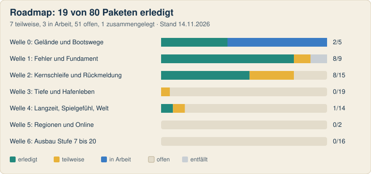
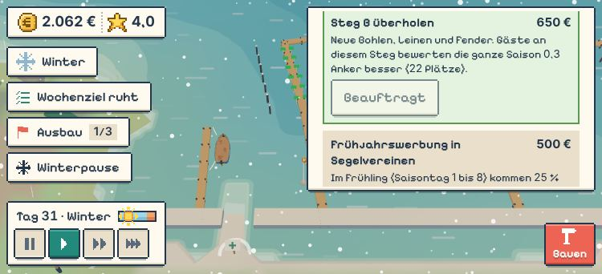
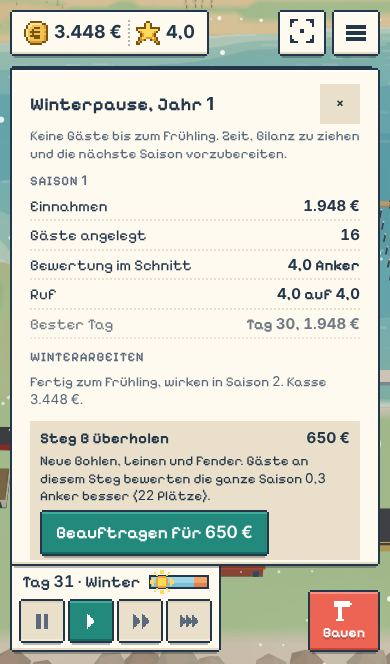
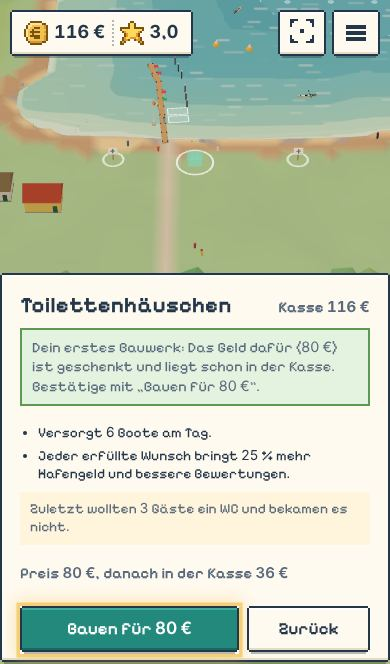
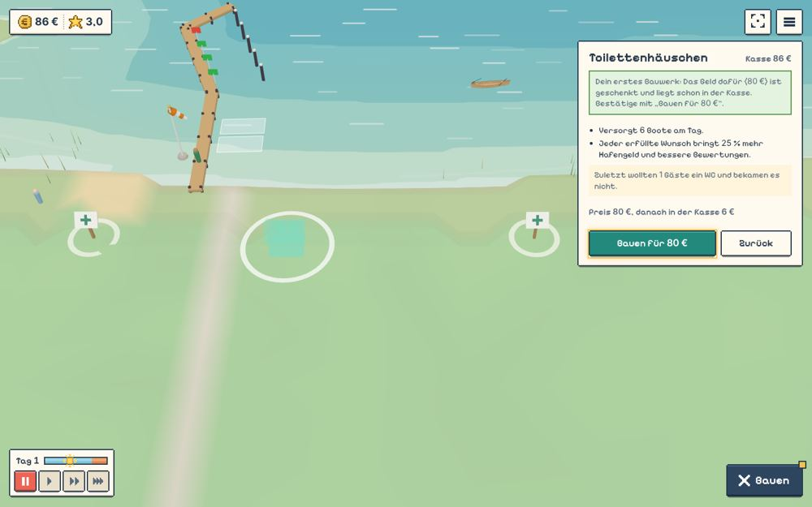
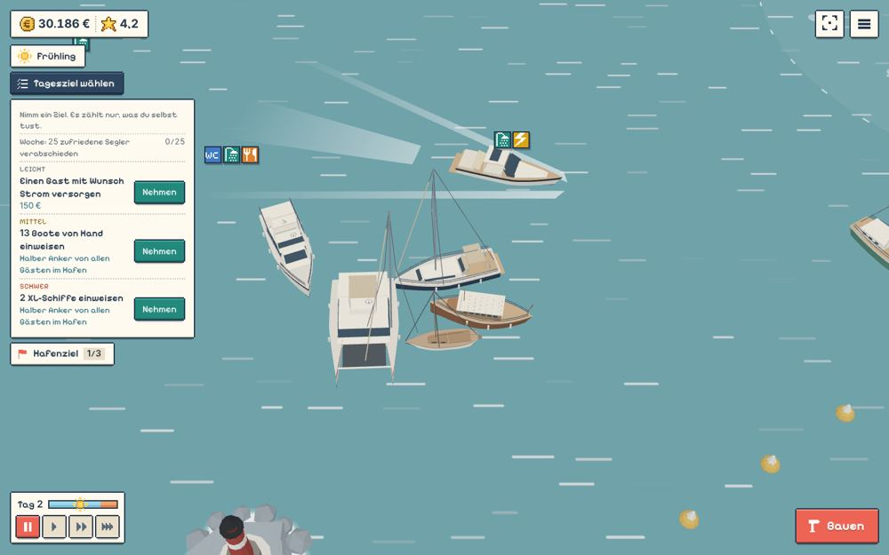
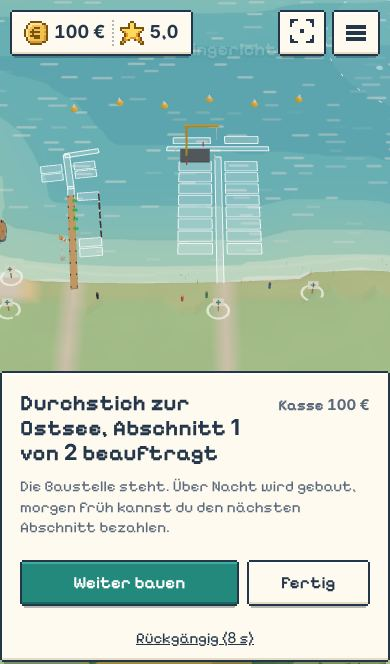
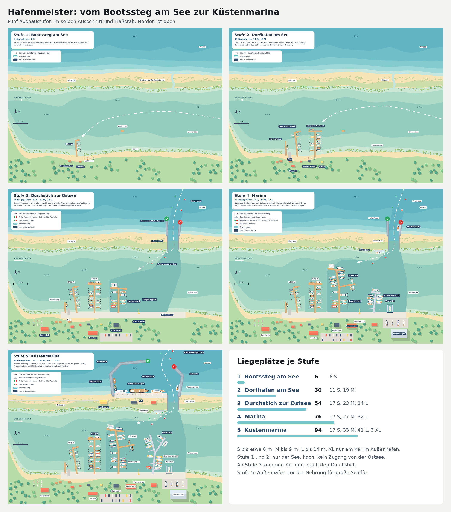

# Hafenmeister

Ein gemütliches Aufbauspiel in 3D für den Browser: Du bist Hafenmeister, fängst mit einem Badesteg an einem Dünensee an und baust ihn Stufe für Stufe zum Seehafen aus, in dem Traditionssegler, Kreuzfahrt- und Marineschiffe festmachen. Boote laufen ein, du weist ihnen einen Liegeplatz zu und streichst das Liegegeld ein. Läuft auf PC, Tablet und Handy, hoch und quer.

**Spielen:** https://hjorven.github.io/hafenmeister/ (Pixel-Fassung: https://hjorven.github.io/hafenmeister/pixel/)

## Stand (13.11.2026)

Die Ostsee ist in allen sechs Stufen spielbar, vom Bootssteg bis zum Seehafen mit Abschlussziel. Jedes Spiel liegt in einer von zehn Geländeformen nach echten Häfen. Gebaut sind Zuweisen und Selbst-Einfahren, Liegegeld beim Festmachen, Bauen mit Vorschau, 20 Services und Angebote an Land, Dauerlieger, Stammgäste, Tagesziele, Wetter, Ereignisse mit Winter, Menschen im Hafen, Ton und Musik, Fotomodus, Speichern und eine Pixel-Oberfläche für alle Geräte. Bis zum Abschluss der Ostsee dauert es etwa 8,5 Stunden.

Zurzeit wird das Gelände mit den Bootswegen überarbeitet (Welle 0), danach arbeiten die Pakete der [Roadmap](docs/roadmap.md) die Funde aus Jorvens Überblick ab. Danach kommen die Nordsee und, als letzter Schritt, ein kleiner Online-Teil. Was sich für Spieler geändert hat, steht in [docs/aenderungen.md](docs/aenderungen.md).

| Stufe | Name | Gastplätze |
|---|---|---|
| 1 | Bootssteg am See | 6 |
| 2 | Dorfhafen am See | 30 |
| 3 | Durchstich zur Ostsee | 54 |
| 4 | Marina | 76 |
| 5 | Küstenmarina | 94 |
| 6 | Seehafen | 94 plus Pier für Großschiffe |

<!-- roadmap:start -->
<!-- Dieser Abschnitt wird aus docs/roadmap.md erzeugt (tools/roadmap.mjs). Bitte dort ändern, nicht hier. -->
## Roadmap

**[Roadmap interaktiv ansehen](https://hjorven.github.io/hafenmeister/roadmap/)**: alle Pakete mit Filter nach Welle und Status, Suche und den Einzelpunkten je Paket. Quelle ist [docs/roadmap.md](docs/roadmap.md).

<a href="https://hjorven.github.io/hafenmeister/roadmap/"></a>

| Welle | Thema | Fortschritt | erledigt | angefangen | offen |
|---|---|---|---|---|---|
| [0](https://hjorven.github.io/hafenmeister/roadmap/#welle=0) | Gelände und Bootswege | `████░░░░░░` 40 % | 0 | 4 | 1 |
| [1](https://hjorven.github.io/hafenmeister/roadmap/#welle=1) | Fehler und Fundament | `█████████░` 94 % | 8 | 1 | 0 |
| [2](https://hjorven.github.io/hafenmeister/roadmap/#welle=2) | Kernschleife und Rückmeldung | `███████░░░` 67 % | 8 | 4 | 3 |
| [3](https://hjorven.github.io/hafenmeister/roadmap/#welle=3) | Tiefe und Hafenleben | `░░░░░░░░░░` 3 % | 0 | 1 | 18 |
| [4](https://hjorven.github.io/hafenmeister/roadmap/#welle=4) | Langzeit, Spielgefühl, Welt | `█░░░░░░░░░` 11 % | 1 | 1 | 12 |
| [5](https://hjorven.github.io/hafenmeister/roadmap/#welle=5) | Regionen und Online | `░░░░░░░░░░` 0 % | 0 | 0 | 2 |
| [6](https://hjorven.github.io/hafenmeister/roadmap/#welle=6) | Ausbau Stufe 7 bis 20 | `░░░░░░░░░░` 0 % | 0 | 0 | 16 |

**Neueste Bilder aus dem Spiel** (antippen öffnet das Paket):

<table><tr>
<td width="33%" valign="top"><a href="https://hjorven.github.io/hafenmeister/roadmap/#paket=P20"></a><br><sub>P20 · Winter im Hafen: Schnee und beauftragte Winterarbeit · PR 245</sub></td>
<td width="33%" valign="top"><a href="https://hjorven.github.io/hafenmeister/roadmap/#paket=P20"></a><br><sub>P20 · Winterpause: Bilanz der Saison und Winterarbeiten · PR 245</sub></td>
<td width="33%" valign="top"><a href="https://hjorven.github.io/hafenmeister/roadmap/#paket=P17"></a><br><sub>P17 · Erstes Bauwerk geschenkt: Toilettenhäuschen · PR 237</sub></td>
</tr><tr>
<td width="33%" valign="top"><a href="https://hjorven.github.io/hafenmeister/roadmap/#paket=P17"></a><br><sub>P17 · Erstes Bauwerk geschenkt: Toilettenhäuschen · PR 237</sub></td>
<td width="33%" valign="top"><a href="https://hjorven.github.io/hafenmeister/roadmap/#paket=P66"></a><br><sub>P66 · Boote sammeln sich als Pulk an der Einfahrt · PR 228</sub></td>
<td width="33%" valign="top"><a href="https://hjorven.github.io/hafenmeister/roadmap/#paket=P18"></a><br><sub>P18 · Ausbau in Abschnitten · PR 232</sub></td>
</tr></table>

<details><summary><b>Welle 0: Gelände und Bootswege</b> (0 von 5 erledigt)</summary>

| Paket | Titel | Status | PRs |
|---|---|---|---|
| [P62](https://hjorven.github.io/hafenmeister/roadmap/#paket=P62) | Geländeform und Engpass neu bauen | in Arbeit | [#211](https://github.com/hjorven/hafenmeister/pull/211) [#216](https://github.com/hjorven/hafenmeister/pull/216) [#224](https://github.com/hjorven/hafenmeister/pull/224) [#229](https://github.com/hjorven/hafenmeister/pull/229) |
| [P63](https://hjorven.github.io/hafenmeister/roadmap/#paket=P63) | Marinebasis und Anlagen neu platzieren | in Arbeit | [#172](https://github.com/hjorven/hafenmeister/pull/172) |
| [P64](https://hjorven.github.io/hafenmeister/roadmap/#paket=P64) | Gelände abwechslungsreicher gestalten | in Arbeit | [#204](https://github.com/hjorven/hafenmeister/pull/204) [#211](https://github.com/hjorven/hafenmeister/pull/211) [#216](https://github.com/hjorven/hafenmeister/pull/216) |
| [P65](https://hjorven.github.io/hafenmeister/roadmap/#paket=P65) | Wetter und Effekte flüssig machen | offen |  |
| [P66](https://hjorven.github.io/hafenmeister/roadmap/#paket=P66) | Boote ums Gelände herum führen | in Arbeit | [#181](https://github.com/hjorven/hafenmeister/pull/181) [#199](https://github.com/hjorven/hafenmeister/pull/199) [#228](https://github.com/hjorven/hafenmeister/pull/228) [#240](https://github.com/hjorven/hafenmeister/pull/240) |

</details>

<details><summary><b>Welle 1: Fehler und Fundament</b> (8 von 9 erledigt)</summary>

| Paket | Titel | Status | PRs |
|---|---|---|---|
| [P01](https://hjorven.github.io/hafenmeister/roadmap/#paket=P01) | Dauerlieger zur echten Entscheidung machen | **erledigt** | [#149](https://github.com/hjorven/hafenmeister/pull/149) [#226](https://github.com/hjorven/hafenmeister/pull/226) |
| [P02](https://hjorven.github.io/hafenmeister/roadmap/#paket=P02) | Hafenbüro mit eigenen Aufgaben ausbauen | **erledigt** | [#146](https://github.com/hjorven/hafenmeister/pull/146) [#151](https://github.com/hjorven/hafenmeister/pull/151) [#158](https://github.com/hjorven/hafenmeister/pull/158) |
| [P03](https://hjorven.github.io/hafenmeister/roadmap/#paket=P03) | Einstieg an neue Oberfläche anpassen | teilweise | [#112](https://github.com/hjorven/hafenmeister/pull/112) [#225](https://github.com/hjorven/hafenmeister/pull/225) [#237](https://github.com/hjorven/hafenmeister/pull/237) |
| [P04](https://hjorven.github.io/hafenmeister/roadmap/#paket=P04) | Abschlussziel Stufe 6 richtig zählen | **erledigt** | [#139](https://github.com/hjorven/hafenmeister/pull/139) |
| [P05](https://hjorven.github.io/hafenmeister/roadmap/#paket=P05) | Boote auf wegfallenden Plätzen regeln | **erledigt** | [#143](https://github.com/hjorven/hafenmeister/pull/143) [#232](https://github.com/hjorven/hafenmeister/pull/232) |
| [P06](https://hjorven.github.io/hafenmeister/roadmap/#paket=P06) | Eine Quelle für alle Zahlen und echte Regeltests | **erledigt** |  |
| [P07](https://hjorven.github.io/hafenmeister/roadmap/#paket=P07) | Tempo einheitlich regeln | **erledigt** |  |
| [P08](https://hjorven.github.io/hafenmeister/roadmap/#paket=P08) | Doku auf den Stand bringen | **erledigt** | [#144](https://github.com/hjorven/hafenmeister/pull/144) [#177](https://github.com/hjorven/hafenmeister/pull/177) |
| [P09](https://hjorven.github.io/hafenmeister/roadmap/#paket=P09) | Speicherplätze und Neues Spiel | **erledigt** | [#150](https://github.com/hjorven/hafenmeister/pull/150) |
| [P54](https://hjorven.github.io/hafenmeister/roadmap/#paket=P54) | Ausfahrende Boote weichen wartenden Booten aus | entfällt |  |

</details>

<details><summary><b>Welle 2: Kernschleife und Rückmeldung</b> (8 von 15 erledigt)</summary>

| Paket | Titel | Status | PRs |
|---|---|---|---|
| [P10](https://hjorven.github.io/hafenmeister/roadmap/#paket=P10) | Zuweisen wieder zur Entscheidung machen | **erledigt** | [#147](https://github.com/hjorven/hafenmeister/pull/147) [#153](https://github.com/hjorven/hafenmeister/pull/153) [#176](https://github.com/hjorven/hafenmeister/pull/176) |
| [P11](https://hjorven.github.io/hafenmeister/roadmap/#paket=P11) | Wünsche über dem Boot und Ankunftsvorschau | **erledigt** | [#146](https://github.com/hjorven/hafenmeister/pull/146) [#158](https://github.com/hjorven/hafenmeister/pull/158) [#227](https://github.com/hjorven/hafenmeister/pull/227) [#231](https://github.com/hjorven/hafenmeister/pull/231) |
| [P12](https://hjorven.github.io/hafenmeister/roadmap/#paket=P12) | Kassieren verständlich machen | **erledigt** | [#146](https://github.com/hjorven/hafenmeister/pull/146) [#151](https://github.com/hjorven/hafenmeister/pull/151) |
| [P13](https://hjorven.github.io/hafenmeister/roadmap/#paket=P13) | Tagesziele an eigene Handlungen binden | **erledigt** | [#152](https://github.com/hjorven/hafenmeister/pull/152) |
| [P14](https://hjorven.github.io/hafenmeister/roadmap/#paket=P14) | Bewertungen und Gästebuch zeigen | **erledigt** | [#154](https://github.com/hjorven/hafenmeister/pull/154) [#233](https://github.com/hjorven/hafenmeister/pull/233) |
| [P15](https://hjorven.github.io/hafenmeister/roadmap/#paket=P15) | Tagesabschluss am Abend zeigen | **erledigt** | [#159](https://github.com/hjorven/hafenmeister/pull/159) [#239](https://github.com/hjorven/hafenmeister/pull/239) |
| [P16](https://hjorven.github.io/hafenmeister/roadmap/#paket=P16) | Aufstieg und Abschluss feiern, Endlosspiel | **erledigt** | [#156](https://github.com/hjorven/hafenmeister/pull/156) |
| [P17](https://hjorven.github.io/hafenmeister/roadmap/#paket=P17) | Start und frühe Stufen straffen | teilweise | [#237](https://github.com/hjorven/hafenmeister/pull/237) [#250](https://github.com/hjorven/hafenmeister/pull/250) |
| [P18](https://hjorven.github.io/hafenmeister/roadmap/#paket=P18) | Ausbau in Bauabschnitten | **erledigt** | [#143](https://github.com/hjorven/hafenmeister/pull/143) [#232](https://github.com/hjorven/hafenmeister/pull/232) [#235](https://github.com/hjorven/hafenmeister/pull/235) |
| [P19](https://hjorven.github.io/hafenmeister/roadmap/#paket=P19) | Ruf schwerer machen mit Wünschen je Bootsart | teilweise |  |
| [P20](https://hjorven.github.io/hafenmeister/roadmap/#paket=P20) | Winter mit Inhalt füllen | teilweise | [#245](https://github.com/hjorven/hafenmeister/pull/245) |
| [P21](https://hjorven.github.io/hafenmeister/roadmap/#paket=P21) | Logbuch und Hafenchronik zeigen | offen |  |
| [P22](https://hjorven.github.io/hafenmeister/roadmap/#paket=P22) | Erfolge einbauen | offen |  |
| [P55](https://hjorven.github.io/hafenmeister/roadmap/#paket=P55) | Versteckte Regeln im Hafen sichtbar machen | teilweise |  |
| [P61](https://hjorven.github.io/hafenmeister/roadmap/#paket=P61) | Spiel komplett offline startbar | offen |  |

</details>

<details><summary><b>Welle 3: Tiefe und Hafenleben</b> (0 von 19 erledigt)</summary>

| Paket | Titel | Status | PRs |
|---|---|---|---|
| [P23](https://hjorven.github.io/hafenmeister/roadmap/#paket=P23) | Services mit eigener Wirkung | offen |  |
| [P24](https://hjorven.github.io/hafenmeister/roadmap/#paket=P24) | Ereignisse zum Vorbereiten und neue Ereignisse | offen |  |
| [P25](https://hjorven.github.io/hafenmeister/roadmap/#paket=P25) | Stammgäste mit Wirkung und Gästepost | offen |  |
| [P26](https://hjorven.github.io/hafenmeister/roadmap/#paket=P26) | Überraschende Gesten fertig bauen | offen |  |
| [P27](https://hjorven.github.io/hafenmeister/roadmap/#paket=P27) | Päckchen liegen bei vollem Hafen | offen |  |
| [P28](https://hjorven.github.io/hafenmeister/roadmap/#paket=P28) | Anmeldung per Funk | offen |  |
| [P29](https://hjorven.github.io/hafenmeister/roadmap/#paket=P29) | Baggern für tiefere Liegeplätze | offen |  |
| [P30](https://hjorven.github.io/hafenmeister/roadmap/#paket=P30) | Stege nachrüsten | offen |  |
| [P31](https://hjorven.github.io/hafenmeister/roadmap/#paket=P31) | Neue Gästewünsche | offen |  |
| [P32](https://hjorven.github.io/hafenmeister/roadmap/#paket=P32) | Flottillen | teilweise |  |
| [P33](https://hjorven.github.io/hafenmeister/roadmap/#paket=P33) | Liegende Boote umlegen | offen |  |
| [P34](https://hjorven.github.io/hafenmeister/roadmap/#paket=P34) | Wind im Hafen spürbar machen | offen |  |
| [P35](https://hjorven.github.io/hafenmeister/roadmap/#paket=P35) | Preisstufe am Hafenbüro | offen |  |
| [P36](https://hjorven.github.io/hafenmeister/roadmap/#paket=P36) | Bojenfeld im See | offen |  |
| [P37](https://hjorven.github.io/hafenmeister/roadmap/#paket=P37) | Havarist einschleppen | offen |  |
| [P38](https://hjorven.github.io/hafenmeister/roadmap/#paket=P38) | Eigenes Hafenfest ansetzen | offen |  |
| [P39](https://hjorven.github.io/hafenmeister/roadmap/#paket=P39) | Jugendtraining am Segelclub | offen |  |
| [P40](https://hjorven.github.io/hafenmeister/roadmap/#paket=P40) | Seltene Besucher | offen |  |
| [P59](https://hjorven.github.io/hafenmeister/roadmap/#paket=P59) | Stege umbauen und Varianten wählen | offen |  |

</details>

<details><summary><b>Welle 4: Langzeit, Spielgefühl, Welt</b> (1 von 14 erledigt)</summary>

| Paket | Titel | Status | PRs |
|---|---|---|---|
| [P41](https://hjorven.github.io/hafenmeister/roadmap/#paket=P41) | Statistik und Saisonbilanz | offen |  |
| [P42](https://hjorven.github.io/hafenmeister/roadmap/#paket=P42) | Herausforderungen, Wochenhafen und Hafen als Code | offen |  |
| [P43](https://hjorven.github.io/hafenmeister/roadmap/#paket=P43) | Fotoaufträge und Postkarten | offen |  |
| [P44](https://hjorven.github.io/hafenmeister/roadmap/#paket=P44) | Hafenname und Flagge | teilweise |  |
| [P45](https://hjorven.github.io/hafenmeister/roadmap/#paket=P45) | Kreativmodus | offen |  |
| [P46](https://hjorven.github.io/hafenmeister/roadmap/#paket=P46) | Ruhiger Abend und Serien-Akkord | offen |  |
| [P47](https://hjorven.github.io/hafenmeister/roadmap/#paket=P47) | Große Ankünfte ankündigen | offen |  |
| [P48](https://hjorven.github.io/hafenmeister/roadmap/#paket=P48) | Leinen annehmen beim Anlegen | offen |  |
| [P49](https://hjorven.github.io/hafenmeister/roadmap/#paket=P49) | Signalflaggen und Hafenwissen | offen |  |
| [P50](https://hjorven.github.io/hafenmeister/roadmap/#paket=P50) | Einstellungen für Sicht und Bewegung | **erledigt** |  |
| [P51](https://hjorven.github.io/hafenmeister/roadmap/#paket=P51) | Hafentiere | offen |  |
| [P52](https://hjorven.github.io/hafenmeister/roadmap/#paket=P52) | Naturecke am Schilf | offen |  |
| [P53](https://hjorven.github.io/hafenmeister/roadmap/#paket=P53) | Spätankömmling in der Nacht | offen |  |
| [P60](https://hjorven.github.io/hafenmeister/roadmap/#paket=P60) | Hafen verschönern | offen |  |

</details>

<details><summary><b>Welle 5: Regionen und Online</b> (0 von 2 erledigt)</summary>

| Paket | Titel | Status | PRs |
|---|---|---|---|
| [P57](https://hjorven.github.io/hafenmeister/roadmap/#paket=P57) | Nordsee mit Gezeiten spielbar machen | offen | [#177](https://github.com/hjorven/hafenmeister/pull/177) |
| [P58](https://hjorven.github.io/hafenmeister/roadmap/#paket=P58) | Online mit Supabase | offen |  |

</details>

<details><summary><b>Welle 6: Ausbau Stufe 7 bis 20</b> (0 von 16 erledigt)</summary>

| Paket | Titel | Status | PRs |
|---|---|---|---|
| [P67](https://hjorven.github.io/hafenmeister/roadmap/#paket=P67) | Stufe-6-Annahmen lösen | offen |  |
| [P68](https://hjorven.github.io/hafenmeister/roadmap/#paket=P68) | Leistung für große Häfen | offen |  |
| [P69](https://hjorven.github.io/hafenmeister/roadmap/#paket=P69) | Bedienung großer Häfen | offen |  |
| [P70](https://hjorven.github.io/hafenmeister/roadmap/#paket=P70) | Stufe 7 Hafenstadt | offen |  |
| [P71](https://hjorven.github.io/hafenmeister/roadmap/#paket=P71) | Stufe 8 Fährhafen | offen |  |
| [P72](https://hjorven.github.io/hafenmeister/roadmap/#paket=P72) | Stufe 9 Werfthafen | offen |  |
| [P73](https://hjorven.github.io/hafenmeister/roadmap/#paket=P73) | Stufe 10 Hafenverbund und Hafenkarten | offen |  |
| [P74](https://hjorven.github.io/hafenmeister/roadmap/#paket=P74) | Stufe 11 Gästeweitergabe und Törngäste | offen |  |
| [P75](https://hjorven.github.io/hafenmeister/roadmap/#paket=P75) | Stufe 12 Hafenprofile | offen |  |
| [P76](https://hjorven.github.io/hafenmeister/roadmap/#paket=P76) | Stufe 13 Regattawoche | offen |  |
| [P77](https://hjorven.github.io/hafenmeister/roadmap/#paket=P77) | Stufe 14 Nordseehafen | offen |  |
| [P78](https://hjorven.github.io/hafenmeister/roadmap/#paket=P78) | Stufe 15 Offshore-Hafen | offen |  |
| [P79](https://hjorven.github.io/hafenmeister/roadmap/#paket=P79) | Stufe 16 Kreuzfahrthafen | offen |  |
| [P80](https://hjorven.github.io/hafenmeister/roadmap/#paket=P80) | Stufe 17 und 18 Marinehafen und Großseglertreffen | offen |  |
| [P81](https://hjorven.github.io/hafenmeister/roadmap/#paket=P81) | Stufe 19 Kanalhafen | offen |  |
| [P82](https://hjorven.github.io/hafenmeister/roadmap/#paket=P82) | Stufe 20 Hafenimperium | offen |  |

</details>

<!-- roadmap:end -->

## Wegweiser

| Dokument | Inhalt |
|---|---|
| [docs/plan.md](docs/plan.md) | Spielplan (gilt): Vision, Regeln, Stufen, Schiffe, Services, Steuerung, Technik, Stand und Entscheidungen |
| [docs/roadmap.md](docs/roadmap.md) | Arbeitsliste: was fehlt, was falsch ist, was weg soll, welches Paket es erledigt |
| [docs/aenderungen.md](docs/aenderungen.md) | Was ist neu im Spiel |
| [docs/ui/oberflaeche.md](docs/ui/oberflaeche.md) | Oberfläche und Bedienung auf allen Geräten |
| [docs/tests.md](docs/tests.md) | Tests vor jedem Merge, Testmodus und alle Adresszusätze |
| [docs/grundgeruest.md](docs/grundgeruest.md) | Technik: Spielobjekt, Module, Koordinaten, Dateibesitz |
| [docs/abnahme.md](docs/abnahme.md) | Regel "Fertig heißt spielbar" |
| [docs/hafen-und-schiffe.md](docs/hafen-und-schiffe.md) | Katalog: Hafen von oben, Liegeplätze, Einlaufen, Schiffsarten und Modelle |

Wo sich Dokumente widersprechen, gilt `docs/plan.md`. Alte Fassungen liegen in `docs/archiv/`.

## Ordner

| Ordner | Was drin ist |
|---|---|
| [web](web) | Das Spiel, wird auf GitHub Pages veröffentlicht (kein Build-Schritt) |
| [web/pixel](web/pixel) | Die Pixel-Fassung |
| [docs](docs) | Plan, Roadmap und Beschreibungen der Teile |
| [tests](tests) | Automatische Tests für Handy, Tablet und PC |
| [tools](tools) | Balancing-Simulation `balance.mjs`, Prüfskripte, Stegbilder erzeugen |
| [skripte](skripte) | Liegeplätze aus dem Hafenplan exportieren, Konzeptbilder |

## Lokal spielen und prüfen

```bash
python3 -m http.server 8000 --directory web
```

Danach `http://localhost:8000` öffnen. Vor jedem Merge im Hauptordner:

```bash
bash tests/pruefen.sh
```

Am Ende muss `Alles grün.` stehen. Einzelheiten in [docs/tests.md](docs/tests.md).


