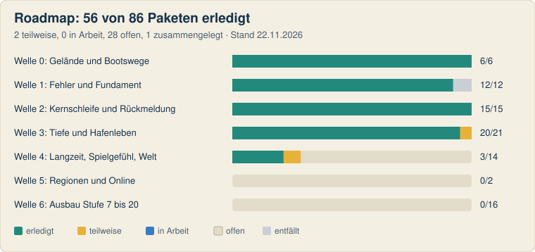
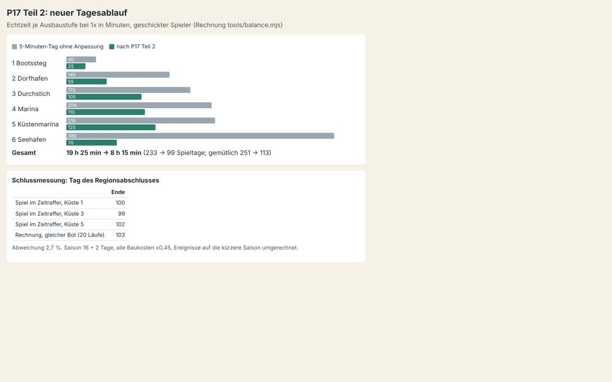
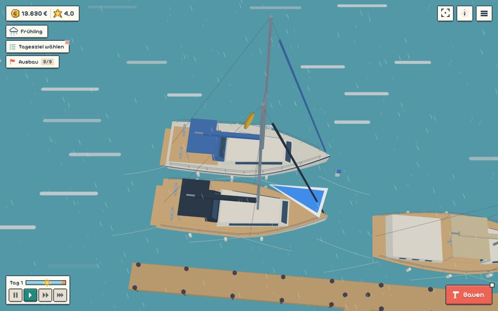
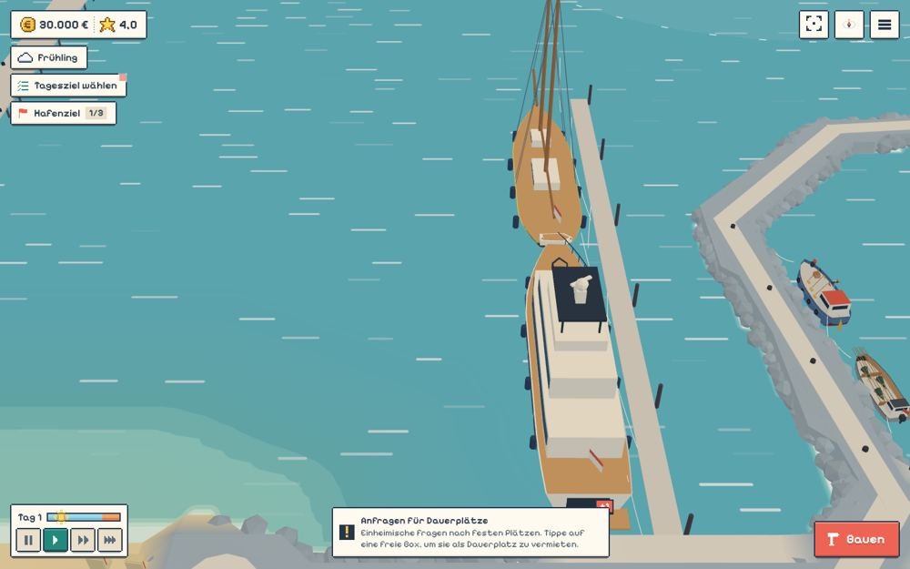
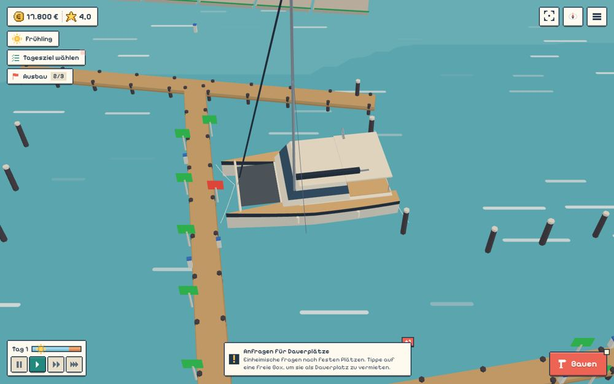
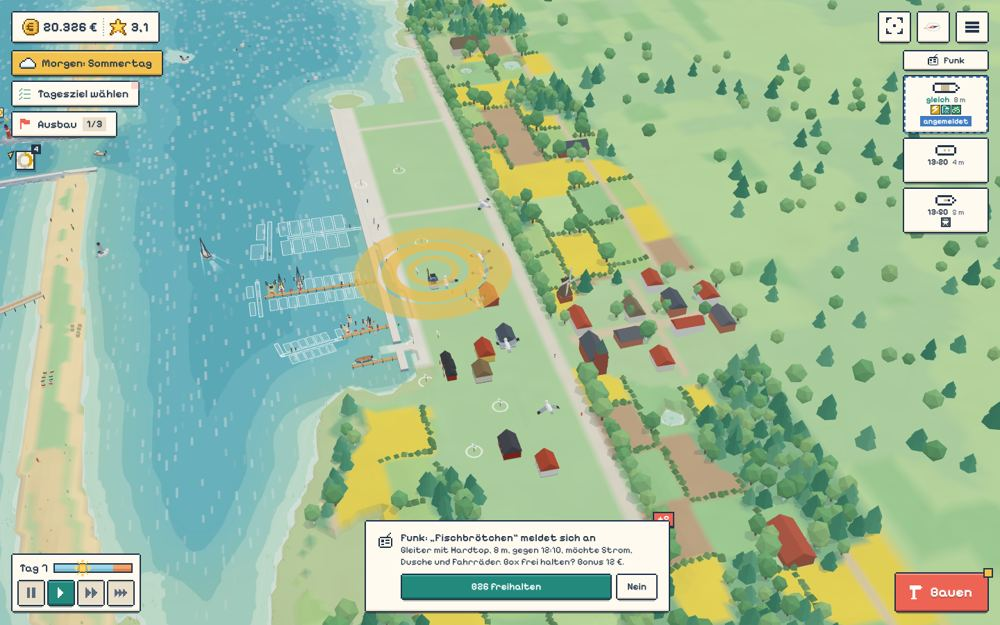
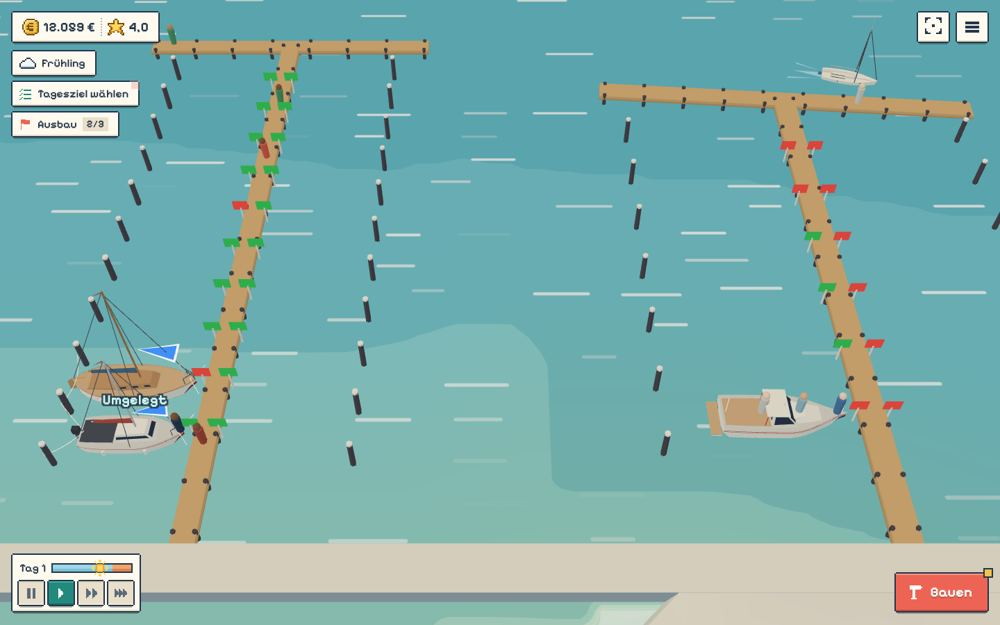
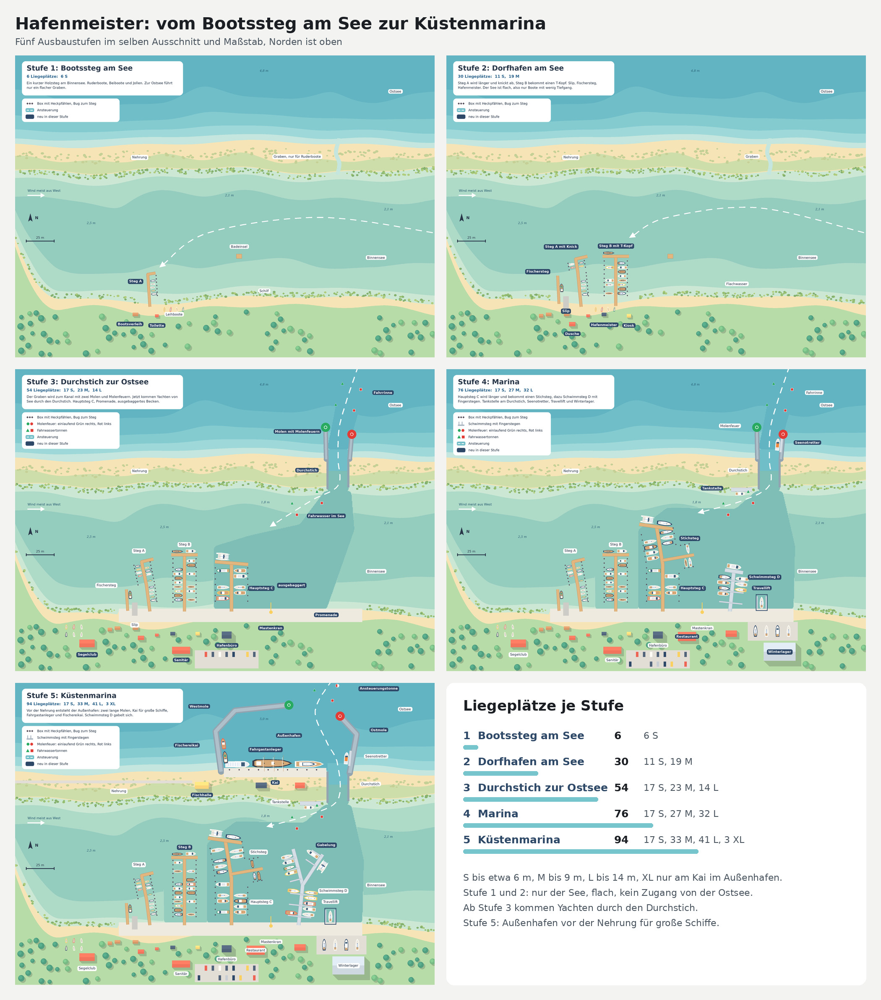

# Hafenmeister

Ein gemütliches Aufbauspiel in 3D für den Browser: Du bist Hafenmeister, fängst mit einem Badesteg an einem Dünensee an und baust ihn Stufe für Stufe zum Seehafen aus, in dem Traditionssegler, Kreuzfahrt- und Marineschiffe festmachen. Boote laufen ein, du weist ihnen einen Liegeplatz zu und streichst das Liegegeld ein. Läuft auf PC, Tablet und Handy, hoch und quer.

**Spielen:** https://hjorven.github.io/hafenmeister/ (Pixel-Fassung: https://hjorven.github.io/hafenmeister/pixel/)

## Stand (15.11.2026)

Die Ostsee ist in allen sechs Stufen spielbar, vom Bootssteg bis zum Seehafen mit Abschlussziel und Endlosspiel. Jedes Spiel liegt an einer von 15 Küsten (zehn nach Vorbildern an Ost- und Nordsee, fünf aus echten Karten), mit eigenem Seeweg hinaus. Ein Spieltag dauert 5 Minuten. Im Spiel sind unter anderem:

- **Kernspiel:** Boote kommen von weit draußen auf See und warten an Wartebojen seitlich der Stege; Zuweisen per Schleppleine oder Selbst-Einfahren in die nächste freie Box, Wunschplätze in Gold, Geduldsring an der Boje, Ankunftsvorschau und Anmeldung per Funk, Kurzhalter und Übernachter mit 65 Bootsgeschichten, Liegegeld je Meter beim Festmachen, liegende Boote umlegen, Päckchen bei vollem Hafen, Hafenbüro mit Funk, Kassenautomat und Leitstelle (Sonderfälle bleiben beim Spieler).
- **Rückmeldung:** Bewertungen über dem Boot, Gästebuch, Tagesabschluss, Statistik und Saisonbilanz, Auslastung an der Versorgung mit Schlange davor, Ruf mit Auszeichnung am Hafenmeisterhaus, 30 Erfolge, Feier beim Stufenaufstieg und Endlosspiel nach dem Abschluss, ein ruhiger Meldeplatz für alle kurzen Meldungen.
- **Bauen:** Vorschau am Ort, Ausbau in Abschnitten mit Baustelle über Nacht, Sparziel, Kauf zurücknehmen, erstes Bauwerk geschenkt, Stege nachrüsten (Fingerstege, Laternen), Doppelboxen und Yachtsteg, 20 Services und Angebote an Land; Gebäude und Dorf wachsen sichtbar mit jeder Stufe.
- **Hafenleben:** Dauerlieger mit Saisonvertrag, Stammgäste, Tagesziele zum Auswählen, Wetter, neun Ereignisse zum Vorbereiten (Sturm, Regatta mit Bahn vor dem Hafen, Hanse-Woche, Mittsommer und andere), Winterpause mit Winterarbeiten und Krantagen, Logbuch als Sammelalbum mit Hafenchronik, Menschen auf dem echten Gelände, Gesten (Hafenhorn, Fernglas, Möwen, Glocke), Ton und Musik, Fotomodus.
- **Technik:** bis zu 8 Speicherplätze mit "Neues Spiel", Einstellungen für Sicht und Bewegung, Pixel-Oberfläche für alle Geräte, freie Kamera, startet als Web-App auch offline.

Nach der Balancing-Rechnung (P17, PR 331) dauert die Ostsee 99 bis 113 Spieltage, rund 8 bis 9,5 Stunden bei normaler Geschwindigkeit.

**Woran gerade gearbeitet wird:** Welle 0 abschließen (kein Pulk beim gleichzeitigen Ablegen, Großschiffe sauber durch jedes Seegatt, Abnahme über alle 15 Küsten), danach die Zusammenspiel-Prüfung des ganzen Spiels. Daneben Services mit eigener Wirkung und die nächsten Pakete aus dem [Arbeitsplan](docs/arbeitsplan.md); alle offenen Punkte in der [Roadmap](docs/roadmap.md). Danach folgen die Nordsee, der Ausbau bis Stufe 20 ([Plan](docs/ausbau-stufe-7-20.md)) und als letzter Schritt ein kleiner Online-Teil. Was sich für Spieler geändert hat, steht in [docs/aenderungen.md](docs/aenderungen.md).

| Stufe | Name | Gastplätze |
|---|---|---|
| 1 | Bootssteg am See | 6 |
| 2 | Dorfhafen am See | 30 |
| 3 | Durchstich zur Ostsee | 54 |
| 4 | Marina | 76 |
| 5 | Küstenmarina | 94 |
| 6 | Seehafen | 96 mit Yachtsteg, plus Pier für Großschiffe |

<!-- roadmap:start -->
<!-- Dieser Abschnitt wird aus docs/roadmap.md erzeugt (tools/roadmap.mjs). Bitte dort ändern, nicht hier. -->
## Roadmap

**[Roadmap interaktiv ansehen](https://hjorven.github.io/hafenmeister/roadmap/)**: alle Pakete mit Filter nach Welle und Status, Suche und den Einzelpunkten je Paket. Quelle ist [docs/roadmap.md](docs/roadmap.md).

<a href="https://hjorven.github.io/hafenmeister/roadmap/"></a>

| Welle | Thema | Fortschritt | erledigt | angefangen | offen |
|---|---|---|---|---|---|
| [0](https://hjorven.github.io/hafenmeister/roadmap/#welle=0) | Gelände und Bootswege | `████████░░` 75 % | 4 | 1 | 1 |
| [1](https://hjorven.github.io/hafenmeister/roadmap/#welle=1) | Fehler und Fundament | `███████░░░` 71 % | 8 | 1 | 3 |
| [2](https://hjorven.github.io/hafenmeister/roadmap/#welle=2) | Kernschleife und Rückmeldung | `██████████` 97 % | 14 | 1 | 0 |
| [3](https://hjorven.github.io/hafenmeister/roadmap/#welle=3) | Tiefe und Hafenleben | `████░░░░░░` 35 % | 7 | 0 | 13 |
| [4](https://hjorven.github.io/hafenmeister/roadmap/#welle=4) | Langzeit, Spielgefühl, Welt | `██░░░░░░░░` 18 % | 2 | 1 | 11 |
| [5](https://hjorven.github.io/hafenmeister/roadmap/#welle=5) | Regionen und Online | `░░░░░░░░░░` 0 % | 0 | 0 | 2 |
| [6](https://hjorven.github.io/hafenmeister/roadmap/#welle=6) | Ausbau Stufe 7 bis 20 | `░░░░░░░░░░` 0 % | 0 | 0 | 16 |

**Neueste Bilder aus dem Spiel** (antippen öffnet das Paket):

<table><tr>
<td width="33%" valign="top"><a href="https://hjorven.github.io/hafenmeister/roadmap/#paket=P17"></a><br><sub>P17 · Neuer Tagesablauf: Echtzeit je Stufe vorher und nachher · PR 331</sub></td>
<td width="33%" valign="top"><a href="https://hjorven.github.io/hafenmeister/roadmap/#paket=P27"></a><br><sub>P27 · Zwei Boote im Päckchen, nah (PC) · PR 330</sub></td>
<td width="33%" valign="top"><a href="https://hjorven.github.io/hafenmeister/roadmap/#paket=P59"></a><br><sub>P59 · Große Yachten am Yachtsteg (PC) · PR 326</sub></td>
</tr><tr>
<td width="33%" valign="top"><a href="https://hjorven.github.io/hafenmeister/roadmap/#paket=P59"></a><br><sub>P59 · Katamaran in der Doppelbox (PC) · PR 321</sub></td>
<td width="33%" valign="top"><a href="https://hjorven.github.io/hafenmeister/roadmap/#paket=P26"></a><br><sub>P26 · Hafenhorn mit Wellenringen am PC · PR 322</sub></td>
<td width="33%" valign="top"><a href="https://hjorven.github.io/hafenmeister/roadmap/#paket=P33"></a><br><sub>P33 · Boot umgelegt (PC) · PR 314</sub></td>
</tr></table>

<details><summary><b>Welle 0: Gelände und Bootswege</b> (4 von 6 erledigt)</summary>

| Paket | Titel | Status | PRs |
|---|---|---|---|
| [P62](https://hjorven.github.io/hafenmeister/roadmap/#paket=P62) | Geländeform und Engpass neu bauen | **erledigt** | [#246](https://github.com/hjorven/hafenmeister/pull/246) [#262](https://github.com/hjorven/hafenmeister/pull/262) [#271](https://github.com/hjorven/hafenmeister/pull/271) [#300](https://github.com/hjorven/hafenmeister/pull/300) |
| [P63](https://hjorven.github.io/hafenmeister/roadmap/#paket=P63) | Marinebasis und Anlagen neu platzieren | **erledigt** | [#167](https://github.com/hjorven/hafenmeister/pull/167) [#172](https://github.com/hjorven/hafenmeister/pull/172) |
| [P64](https://hjorven.github.io/hafenmeister/roadmap/#paket=P64) | Gelände abwechslungsreicher gestalten | **erledigt** | [#204](https://github.com/hjorven/hafenmeister/pull/204) [#211](https://github.com/hjorven/hafenmeister/pull/211) [#216](https://github.com/hjorven/hafenmeister/pull/216) |
| [P65](https://hjorven.github.io/hafenmeister/roadmap/#paket=P65) | Wetter und Effekte flüssig machen | **erledigt** | [#169](https://github.com/hjorven/hafenmeister/pull/169) |
| [P66](https://hjorven.github.io/hafenmeister/roadmap/#paket=P66) | Boote ums Gelände herum führen | in Arbeit | [#262](https://github.com/hjorven/hafenmeister/pull/262) [#280](https://github.com/hjorven/hafenmeister/pull/280) [#327](https://github.com/hjorven/hafenmeister/pull/327) [#332](https://github.com/hjorven/hafenmeister/pull/332) |
| [P84](https://hjorven.github.io/hafenmeister/roadmap/#paket=P84) | Großschiffwege an allen 15 Küsten | offen | [#329](https://github.com/hjorven/hafenmeister/pull/329) |

</details>

<details><summary><b>Welle 1: Fehler und Fundament</b> (8 von 12 erledigt)</summary>

| Paket | Titel | Status | PRs |
|---|---|---|---|
| [P01](https://hjorven.github.io/hafenmeister/roadmap/#paket=P01) | Dauerlieger zur echten Entscheidung machen | **erledigt** | [#149](https://github.com/hjorven/hafenmeister/pull/149) [#226](https://github.com/hjorven/hafenmeister/pull/226) |
| [P02](https://hjorven.github.io/hafenmeister/roadmap/#paket=P02) | Hafenbüro mit eigenen Aufgaben ausbauen | **erledigt** | [#146](https://github.com/hjorven/hafenmeister/pull/146) [#151](https://github.com/hjorven/hafenmeister/pull/151) [#158](https://github.com/hjorven/hafenmeister/pull/158) [#288](https://github.com/hjorven/hafenmeister/pull/288) |
| [P03](https://hjorven.github.io/hafenmeister/roadmap/#paket=P03) | Einstieg an neue Oberfläche anpassen | teilweise | [#112](https://github.com/hjorven/hafenmeister/pull/112) [#225](https://github.com/hjorven/hafenmeister/pull/225) [#237](https://github.com/hjorven/hafenmeister/pull/237) |
| [P04](https://hjorven.github.io/hafenmeister/roadmap/#paket=P04) | Abschlussziel Stufe 6 richtig zählen | **erledigt** | [#113](https://github.com/hjorven/hafenmeister/pull/113) [#139](https://github.com/hjorven/hafenmeister/pull/139) |
| [P05](https://hjorven.github.io/hafenmeister/roadmap/#paket=P05) | Boote auf wegfallenden Plätzen regeln | **erledigt** | [#143](https://github.com/hjorven/hafenmeister/pull/143) [#232](https://github.com/hjorven/hafenmeister/pull/232) |
| [P06](https://hjorven.github.io/hafenmeister/roadmap/#paket=P06) | Eine Quelle für alle Zahlen und echte Regeltests | **erledigt** |  |
| [P07](https://hjorven.github.io/hafenmeister/roadmap/#paket=P07) | Tempo einheitlich regeln | **erledigt** | [#257](https://github.com/hjorven/hafenmeister/pull/257) [#278](https://github.com/hjorven/hafenmeister/pull/278) |
| [P08](https://hjorven.github.io/hafenmeister/roadmap/#paket=P08) | Doku auf den Stand bringen | **erledigt** | [#144](https://github.com/hjorven/hafenmeister/pull/144) [#177](https://github.com/hjorven/hafenmeister/pull/177) |
| [P09](https://hjorven.github.io/hafenmeister/roadmap/#paket=P09) | Speicherplätze und Neues Spiel | **erledigt** | [#150](https://github.com/hjorven/hafenmeister/pull/150) |
| [P54](https://hjorven.github.io/hafenmeister/roadmap/#paket=P54) | Ausfahrende Boote weichen wartenden Booten aus | entfällt |  |
| [P83](https://hjorven.github.io/hafenmeister/roadmap/#paket=P83) | Stegbild-Generator reparieren | offen | [#321](https://github.com/hjorven/hafenmeister/pull/321) [#329](https://github.com/hjorven/hafenmeister/pull/329) |
| [P85](https://hjorven.github.io/hafenmeister/roadmap/#paket=P85) | Zusammenspiel nach Welle 0 prüfen | offen |  |
| [P87](https://hjorven.github.io/hafenmeister/roadmap/#paket=P87) | Prüfwerkzeuge auf 15 Küsten und den neuen Takt | offen | [#327](https://github.com/hjorven/hafenmeister/pull/327) [#332](https://github.com/hjorven/hafenmeister/pull/332) |

</details>

<details><summary><b>Welle 2: Kernschleife und Rückmeldung</b> (14 von 15 erledigt)</summary>

| Paket | Titel | Status | PRs |
|---|---|---|---|
| [P10](https://hjorven.github.io/hafenmeister/roadmap/#paket=P10) | Zuweisen wieder zur Entscheidung machen | **erledigt** | [#147](https://github.com/hjorven/hafenmeister/pull/147) [#153](https://github.com/hjorven/hafenmeister/pull/153) [#176](https://github.com/hjorven/hafenmeister/pull/176) |
| [P11](https://hjorven.github.io/hafenmeister/roadmap/#paket=P11) | Wünsche über dem Boot und Ankunftsvorschau | **erledigt** | [#146](https://github.com/hjorven/hafenmeister/pull/146) [#158](https://github.com/hjorven/hafenmeister/pull/158) [#227](https://github.com/hjorven/hafenmeister/pull/227) [#231](https://github.com/hjorven/hafenmeister/pull/231) |
| [P12](https://hjorven.github.io/hafenmeister/roadmap/#paket=P12) | Kassieren verständlich machen | **erledigt** | [#146](https://github.com/hjorven/hafenmeister/pull/146) [#151](https://github.com/hjorven/hafenmeister/pull/151) |
| [P13](https://hjorven.github.io/hafenmeister/roadmap/#paket=P13) | Tagesziele an eigene Handlungen binden | **erledigt** | [#152](https://github.com/hjorven/hafenmeister/pull/152) |
| [P14](https://hjorven.github.io/hafenmeister/roadmap/#paket=P14) | Bewertungen und Gästebuch zeigen | **erledigt** | [#154](https://github.com/hjorven/hafenmeister/pull/154) [#233](https://github.com/hjorven/hafenmeister/pull/233) |
| [P15](https://hjorven.github.io/hafenmeister/roadmap/#paket=P15) | Tagesabschluss am Abend zeigen | **erledigt** | [#159](https://github.com/hjorven/hafenmeister/pull/159) [#239](https://github.com/hjorven/hafenmeister/pull/239) |
| [P16](https://hjorven.github.io/hafenmeister/roadmap/#paket=P16) | Aufstieg und Abschluss feiern, Endlosspiel | **erledigt** | [#156](https://github.com/hjorven/hafenmeister/pull/156) |
| [P17](https://hjorven.github.io/hafenmeister/roadmap/#paket=P17) | Start und frühe Stufen straffen | **erledigt** | [#287](https://github.com/hjorven/hafenmeister/pull/287) [#318](https://github.com/hjorven/hafenmeister/pull/318) [#319](https://github.com/hjorven/hafenmeister/pull/319) [#331](https://github.com/hjorven/hafenmeister/pull/331) |
| [P18](https://hjorven.github.io/hafenmeister/roadmap/#paket=P18) | Ausbau in Bauabschnitten | **erledigt** | [#143](https://github.com/hjorven/hafenmeister/pull/143) [#232](https://github.com/hjorven/hafenmeister/pull/232) [#235](https://github.com/hjorven/hafenmeister/pull/235) |
| [P19](https://hjorven.github.io/hafenmeister/roadmap/#paket=P19) | Ruf schwerer machen mit Wünschen je Bootsart | **erledigt** | [#244](https://github.com/hjorven/hafenmeister/pull/244) [#279](https://github.com/hjorven/hafenmeister/pull/279) |
| [P20](https://hjorven.github.io/hafenmeister/roadmap/#paket=P20) | Winter mit Inhalt füllen | teilweise | [#245](https://github.com/hjorven/hafenmeister/pull/245) [#249](https://github.com/hjorven/hafenmeister/pull/249) |
| [P21](https://hjorven.github.io/hafenmeister/roadmap/#paket=P21) | Logbuch und Hafenchronik zeigen | **erledigt** | [#274](https://github.com/hjorven/hafenmeister/pull/274) [#305](https://github.com/hjorven/hafenmeister/pull/305) |
| [P22](https://hjorven.github.io/hafenmeister/roadmap/#paket=P22) | Erfolge einbauen | **erledigt** | [#295](https://github.com/hjorven/hafenmeister/pull/295) |
| [P55](https://hjorven.github.io/hafenmeister/roadmap/#paket=P55) | Versteckte Regeln im Hafen sichtbar machen | **erledigt** | [#269](https://github.com/hjorven/hafenmeister/pull/269) [#275](https://github.com/hjorven/hafenmeister/pull/275) |
| [P61](https://hjorven.github.io/hafenmeister/roadmap/#paket=P61) | Spiel komplett offline startbar | **erledigt** | [#270](https://github.com/hjorven/hafenmeister/pull/270) |

</details>

<details><summary><b>Welle 3: Tiefe und Hafenleben</b> (7 von 20 erledigt)</summary>

| Paket | Titel | Status | PRs |
|---|---|---|---|
| [P23](https://hjorven.github.io/hafenmeister/roadmap/#paket=P23) | Services mit eigener Wirkung | offen |  |
| [P24](https://hjorven.github.io/hafenmeister/roadmap/#paket=P24) | Ereignisse zum Vorbereiten und neue Ereignisse | **erledigt** | [#281](https://github.com/hjorven/hafenmeister/pull/281) [#299](https://github.com/hjorven/hafenmeister/pull/299) [#319](https://github.com/hjorven/hafenmeister/pull/319) [#331](https://github.com/hjorven/hafenmeister/pull/331) |
| [P25](https://hjorven.github.io/hafenmeister/roadmap/#paket=P25) | Stammgäste mit Wirkung und Gästepost | offen |  |
| [P26](https://hjorven.github.io/hafenmeister/roadmap/#paket=P26) | Überraschende Gesten fertig bauen | **erledigt** | [#322](https://github.com/hjorven/hafenmeister/pull/322) |
| [P27](https://hjorven.github.io/hafenmeister/roadmap/#paket=P27) | Päckchen liegen bei vollem Hafen | **erledigt** | [#330](https://github.com/hjorven/hafenmeister/pull/330) |
| [P28](https://hjorven.github.io/hafenmeister/roadmap/#paket=P28) | Anmeldung per Funk | **erledigt** | [#288](https://github.com/hjorven/hafenmeister/pull/288) |
| [P29](https://hjorven.github.io/hafenmeister/roadmap/#paket=P29) | Baggern für tiefere Liegeplätze | offen |  |
| [P30](https://hjorven.github.io/hafenmeister/roadmap/#paket=P30) | Stege nachrüsten | **erledigt** | [#297](https://github.com/hjorven/hafenmeister/pull/297) |
| [P31](https://hjorven.github.io/hafenmeister/roadmap/#paket=P31) | Neue Gästewünsche | offen |  |
| [P32](https://hjorven.github.io/hafenmeister/roadmap/#paket=P32) | Flottillen | offen |  |
| [P33](https://hjorven.github.io/hafenmeister/roadmap/#paket=P33) | Liegende Boote umlegen | **erledigt** | [#314](https://github.com/hjorven/hafenmeister/pull/314) |
| [P34](https://hjorven.github.io/hafenmeister/roadmap/#paket=P34) | Wind im Hafen spürbar machen | offen |  |
| [P35](https://hjorven.github.io/hafenmeister/roadmap/#paket=P35) | Preisstufe am Hafenbüro | offen |  |
| [P36](https://hjorven.github.io/hafenmeister/roadmap/#paket=P36) | Bojenfeld im See | offen |  |
| [P37](https://hjorven.github.io/hafenmeister/roadmap/#paket=P37) | Havarist einschleppen | offen |  |
| [P38](https://hjorven.github.io/hafenmeister/roadmap/#paket=P38) | Eigenes Hafenfest ansetzen | offen |  |
| [P39](https://hjorven.github.io/hafenmeister/roadmap/#paket=P39) | Jugendtraining am Segelclub | offen |  |
| [P40](https://hjorven.github.io/hafenmeister/roadmap/#paket=P40) | Seltene Besucher | offen |  |
| [P59](https://hjorven.github.io/hafenmeister/roadmap/#paket=P59) | Stege umbauen und Varianten wählen | **erledigt** | [#321](https://github.com/hjorven/hafenmeister/pull/321) [#326](https://github.com/hjorven/hafenmeister/pull/326) |
| [P86](https://hjorven.github.io/hafenmeister/roadmap/#paket=P86) | Bootsgeschichten fertig erzählen | offen | [#33](https://github.com/hjorven/hafenmeister/pull/33) |

</details>

<details><summary><b>Welle 4: Langzeit, Spielgefühl, Welt</b> (2 von 14 erledigt)</summary>

| Paket | Titel | Status | PRs |
|---|---|---|---|
| [P41](https://hjorven.github.io/hafenmeister/roadmap/#paket=P41) | Statistik und Saisonbilanz | **erledigt** | [#315](https://github.com/hjorven/hafenmeister/pull/315) |
| [P42](https://hjorven.github.io/hafenmeister/roadmap/#paket=P42) | Herausforderungen, Wochenhafen und Hafen als Code | offen |  |
| [P43](https://hjorven.github.io/hafenmeister/roadmap/#paket=P43) | Fotoaufträge und Postkarten | offen |  |
| [P44](https://hjorven.github.io/hafenmeister/roadmap/#paket=P44) | Hafenname und Flagge | teilweise |  |
| [P45](https://hjorven.github.io/hafenmeister/roadmap/#paket=P45) | Kreativmodus | offen |  |
| [P46](https://hjorven.github.io/hafenmeister/roadmap/#paket=P46) | Ruhiger Abend und Serien-Akkord | offen |  |
| [P47](https://hjorven.github.io/hafenmeister/roadmap/#paket=P47) | Große Ankünfte ankündigen | offen |  |
| [P48](https://hjorven.github.io/hafenmeister/roadmap/#paket=P48) | Leinen annehmen beim Anlegen | offen |  |
| [P49](https://hjorven.github.io/hafenmeister/roadmap/#paket=P49) | Signalflaggen und Hafenwissen | offen |  |
| [P50](https://hjorven.github.io/hafenmeister/roadmap/#paket=P50) | Einstellungen für Sicht und Bewegung | **erledigt** |  |
| [P51](https://hjorven.github.io/hafenmeister/roadmap/#paket=P51) | Hafentiere | offen |  |
| [P52](https://hjorven.github.io/hafenmeister/roadmap/#paket=P52) | Naturecke am Schilf | offen |  |
| [P53](https://hjorven.github.io/hafenmeister/roadmap/#paket=P53) | Spätankömmling in der Nacht | offen |  |
| [P60](https://hjorven.github.io/hafenmeister/roadmap/#paket=P60) | Hafen verschönern | offen |  |

</details>

<details><summary><b>Welle 5: Regionen und Online</b> (0 von 2 erledigt)</summary>

| Paket | Titel | Status | PRs |
|---|---|---|---|
| [P57](https://hjorven.github.io/hafenmeister/roadmap/#paket=P57) | Nordsee mit Gezeiten spielbar machen | offen | [#177](https://github.com/hjorven/hafenmeister/pull/177) |
| [P58](https://hjorven.github.io/hafenmeister/roadmap/#paket=P58) | Online mit Supabase | offen |  |

</details>

<details><summary><b>Welle 6: Ausbau Stufe 7 bis 20</b> (0 von 16 erledigt)</summary>

| Paket | Titel | Status | PRs |
|---|---|---|---|
| [P67](https://hjorven.github.io/hafenmeister/roadmap/#paket=P67) | Stufe-6-Annahmen lösen | offen |  |
| [P68](https://hjorven.github.io/hafenmeister/roadmap/#paket=P68) | Leistung für große Häfen | offen |  |
| [P69](https://hjorven.github.io/hafenmeister/roadmap/#paket=P69) | Bedienung großer Häfen | offen |  |
| [P70](https://hjorven.github.io/hafenmeister/roadmap/#paket=P70) | Stufe 7 Hafenstadt | offen |  |
| [P71](https://hjorven.github.io/hafenmeister/roadmap/#paket=P71) | Stufe 8 Fährhafen | offen |  |
| [P72](https://hjorven.github.io/hafenmeister/roadmap/#paket=P72) | Stufe 9 Werfthafen | offen |  |
| [P73](https://hjorven.github.io/hafenmeister/roadmap/#paket=P73) | Stufe 10 Hafenverbund und Hafenkarten | offen |  |
| [P74](https://hjorven.github.io/hafenmeister/roadmap/#paket=P74) | Stufe 11 Gästeweitergabe und Törngäste | offen |  |
| [P75](https://hjorven.github.io/hafenmeister/roadmap/#paket=P75) | Stufe 12 Hafenprofile | offen |  |
| [P76](https://hjorven.github.io/hafenmeister/roadmap/#paket=P76) | Stufe 13 Regattawoche | offen |  |
| [P77](https://hjorven.github.io/hafenmeister/roadmap/#paket=P77) | Stufe 14 Nordseehafen | offen |  |
| [P78](https://hjorven.github.io/hafenmeister/roadmap/#paket=P78) | Stufe 15 Offshore-Hafen | offen |  |
| [P79](https://hjorven.github.io/hafenmeister/roadmap/#paket=P79) | Stufe 16 Kreuzfahrthafen | offen |  |
| [P80](https://hjorven.github.io/hafenmeister/roadmap/#paket=P80) | Stufe 17 und 18 Marinehafen und Großseglertreffen | offen |  |
| [P81](https://hjorven.github.io/hafenmeister/roadmap/#paket=P81) | Stufe 19 Kanalhafen | offen | [#300](https://github.com/hjorven/hafenmeister/pull/300) |
| [P82](https://hjorven.github.io/hafenmeister/roadmap/#paket=P82) | Stufe 20 Hafenimperium | offen |  |

</details>

<!-- roadmap:end -->

## Wegweiser

| Dokument | Inhalt |
|---|---|
| [docs/plan.md](docs/plan.md) | Spielplan (gilt): Vision, Regeln, Stufen, Schiffe, Services, Steuerung, Technik, Stand und Entscheidungen |
| [docs/roadmap.md](docs/roadmap.md) | Arbeitsliste: was fehlt, was falsch ist, was weg soll, welches Paket es erledigt |
| [docs/arbeitsplan.md](docs/arbeitsplan.md) | Was gerade läuft, bekannte Fehler, die nächsten Pakete |
| [docs/ausbau-stufe-7-20.md](docs/ausbau-stufe-7-20.md) | Planung: Stufe 7 bis 20 bis zum Hafenverbund (noch nicht im Spiel) |
| [docs/balancing.md](docs/balancing.md) | Zahlen, Spielzeit je Stufe, Rechnung gegen Zeitraffer |
| [docs/aenderungen.md](docs/aenderungen.md) | Was ist neu im Spiel |
| [docs/ui/oberflaeche.md](docs/ui/oberflaeche.md) | Oberfläche und Bedienung auf allen Geräten |
| [docs/tests.md](docs/tests.md) | Tests vor jedem Merge, Testmodus und alle Adresszusätze |
| [docs/extremtest.md](docs/extremtest.md) | Härtetest in Extremlagen, nach großen Änderungen |
| [docs/grundgeruest.md](docs/grundgeruest.md) | Technik: Spielobjekt, Module, Koordinaten, Dateibesitz |
| [docs/abnahme.md](docs/abnahme.md) | Regel "Fertig heißt spielbar" |
| [docs/hafen-und-schiffe.md](docs/hafen-und-schiffe.md) | Katalog: Hafen von oben, Liegeplätze, Einlaufen, Schiffsarten und Modelle |

Wo sich Dokumente widersprechen, gilt `docs/plan.md`. Alte Fassungen liegen in `docs/archiv/`.

## Ordner

| Ordner | Was drin ist |
|---|---|
| [web](web) | Das Spiel, wird auf GitHub Pages veröffentlicht (kein Build-Schritt) |
| [web/pixel](web/pixel) | Die Pixel-Fassung |
| [docs](docs) | Plan, Roadmap und Beschreibungen der Teile |
| [tests](tests) | Automatische Tests für Handy, Tablet und PC |
| [tools](tools) | Balancing-Simulation `balance.mjs`, Zahlenübersicht `zahlen.mjs`, Roadmap-Seite `roadmap.mjs`, Liegeplatzprüfung, Zeitraffer, Stegbilder erzeugen |
| [skripte](skripte) | Liegeplätze aus dem Hafenplan exportieren, Konzeptbilder |

## Lokal spielen und prüfen

```bash
python3 -m http.server 8000 --directory web
```

Danach `http://localhost:8000` öffnen. Vor jedem Merge im Hauptordner:

```bash
bash tests/pruefen.sh --schnell
```

Am Ende muss `Alles grün.` stehen. Einzelheiten in [docs/tests.md](docs/tests.md).


