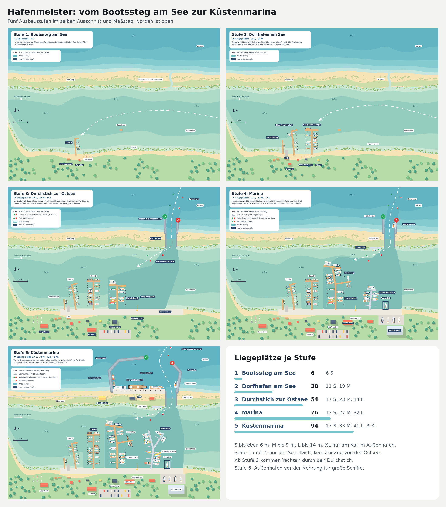
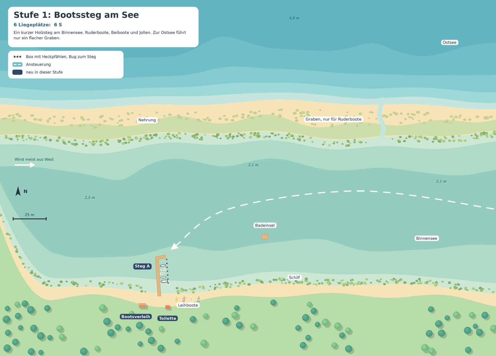
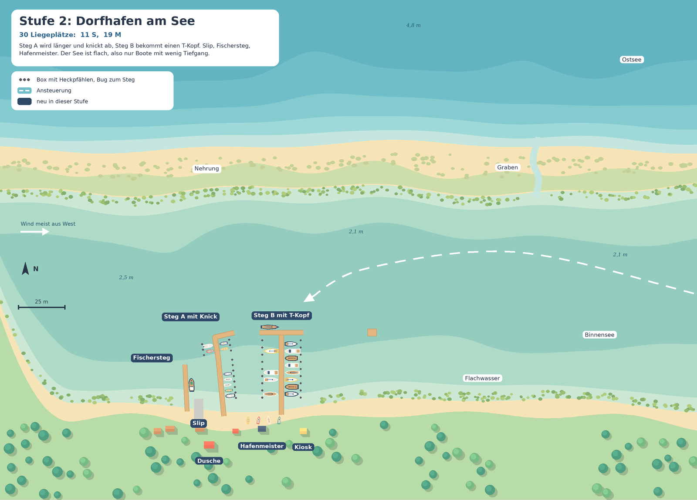
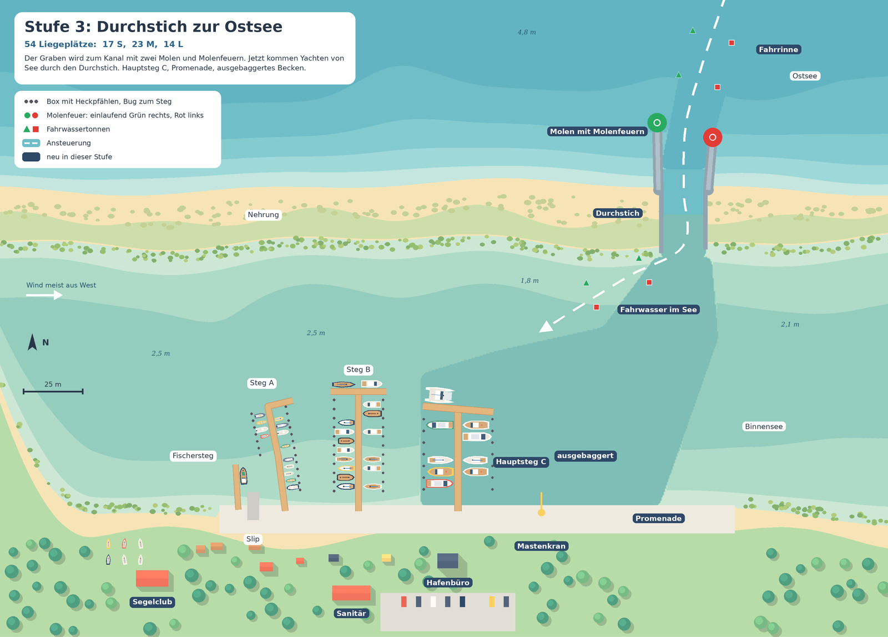
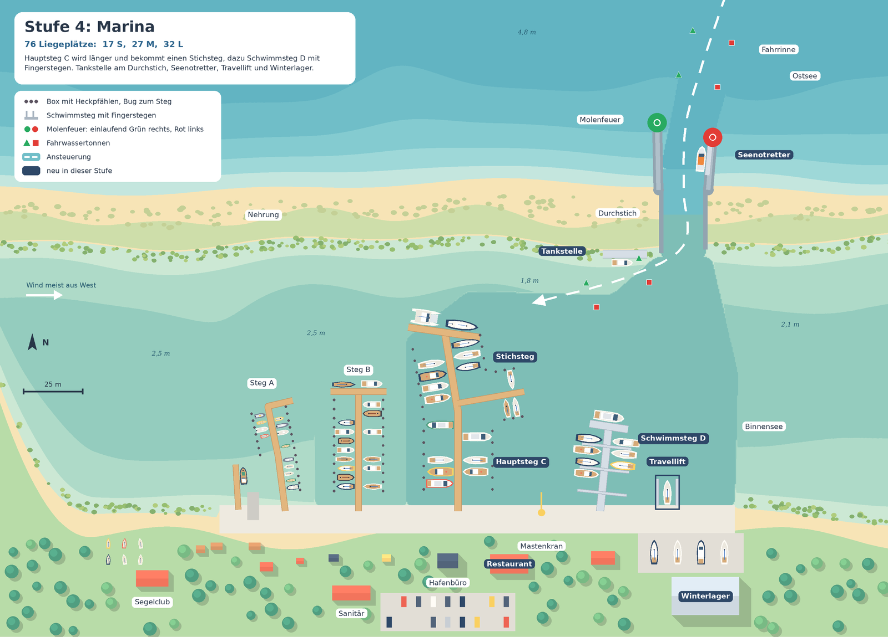
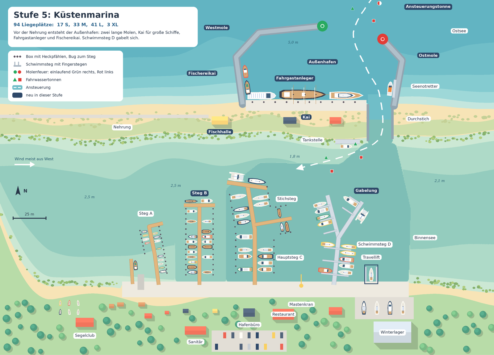

# Hafen und Schiffe

Stand: 11.11.2026. Dieses Dokument ersetzt im [Spielplan](plan.md) die Bootstabelle in Abschnitt 4, die Stege, die Mole und den Kai in Abschnitt 5, die Stufennamen in Abschnitt 6 und den Sturm in Abschnitt 7. Wünsche, Versorgung, Oberfläche und Technik bleiben, wie sie im Spielplan stehen.

**Was sich gegenüber dem Spielplan ändert**

- Der Hafen beginnt nicht am Meer, sondern an einem **Binnensee** hinter einer Nehrung und wächst zur **Küstenmarina**.
- Die Stege sind nicht mehr fünf gleiche gerade Stege. Jeder Steg hat eine eigene Form: Knick, T-Kopf, Stichsteg, Gabelung.
- Der Leuchtturm entfällt. An die Einfahrt gehören **Molenfeuer** (grün und rot) und eine **betonnte Fahrrinne**.
- Statt drei Bootsbeispielen je Größe gibt es **16 Schiffsarten mit je 5 Modellen**, also 80 Modelle mit echten Formunterschieden.
- Etwas mehr Tiefe im Spiel: Ein Boot passt nur, wenn **Länge, Breite und Tiefgang** zum Platz passen.

---

## 1. Vom Bootssteg am See zur Küstenmarina



Die Landschaft von Süden nach Norden: Festland, Binnensee, Nehrung (ein schmaler Streifen aus Strand und Dünen), Ostsee. Der See ist flach und geschützt. Zur Ostsee führt anfangs nur ein flacher Graben.

Ein echtes Vorbild für diese Lage ist der Yachthafen Burgtiefe auf Fehmarn. Er liegt am Burger Binnensee, und die Zufahrt führt durch eine betonnte, 4,5 m tiefe Rinne zwischen Molenköpfen, neben der es sehr flach ist.

| Stufe | Name | Liegeplätze | Neu |
|---|---|---|---|
| 1 | Bootssteg am See | 6 (6 S) | Steg A, Bootsverleih, Toilette |
| 2 | Dorfhafen am See | 30 (11 S, 19 M) | Steg A mit Knick, Steg B mit T-Kopf, Fischersteg, Slip, Hafenmeister, Dusche, Kiosk |
| 3 | Durchstich zur Ostsee | 54 (17 S, 23 M, 14 L) | Kanal durch die Nehrung, zwei Molen mit Molenfeuern, Fahrrinne, ausgebaggertes Becken, Hauptsteg C, Promenade, Mastenkran, Hafenbüro, Sanitärgebäude, Segelclub |
| 4 | Marina | 76 (17 S, 27 M, 32 L) | Hauptsteg C mit Stichsteg, Schwimmsteg D, Tankstelle, Seenotretter, Travellift, Winterlager, Restaurant |
| 5 | Küstenmarina | 94 (17 S, 33 M, 41 L, 3 XL) | Außenhafen mit West- und Ostmole, Kai, Fahrgastanleger, Fischereikai mit Fischhalle, Ansteuerungstonne, Gabelung an Steg D, Steg B verlängert |

Die Zahlen stammen aus den Zeichnungen. Tankstelle und Seenotretter sind keine Liegeplätze und nicht mitgezählt.

### Stufe 1: Bootssteg am See



Ein kurzer Holzsteg mit kleinem Haken am Ende. Ruderboote, Beiboote und Tretboote, dazu ein Bootsverleih und Leihboote am Strand. Die Boote kommen über den See. Der Graben zur Ostsee ist so flach, dass nur Ruderboote durchkommen.

### Stufe 2: Dorfhafen am See



Steg A wird länger und knickt ab. Steg B kommt dazu und bekommt einen T-Kopf, an dem ein längeres Boot längsseits liegen kann. Am Fischersteg liegt das Boot des Seefischers. Der See ist in der Mitte gut 2 m tief, am Ufer unter 1 m. Es kommen also nur Boote mit wenig Tiefgang: Jollen, Jollenkreuzer, kleine Motorboote.

### Stufe 3: Durchstich zur Ostsee



Das große Bauprojekt: Der Graben wird zum Kanal. Zwei kurze Molen schützen die Mündung, an ihren Köpfen stehen Molenfeuer. Vor der Küste und im See markieren Tonnenpaare die Fahrrinne. Vor dem Hafen wird ein Becken ausgebaggert, dort steht der Hauptsteg C für Kielyachten. Das Ufer wird zur Promenade.

### Stufe 4: Marina



Hauptsteg C wird länger, knickt leicht ab und bekommt einen Stichsteg. Schwimmsteg D bringt Fingerstege, also bequemere Plätze. Die Tankstelle liegt am Durchstich, wo jedes Boot vorbeikommt. Der Seenotretter liegt in der Kanalmündung. Travellift und Winterlager stehen am östlichen Ufer.

### Stufe 5: Küstenmarina



Vor der Nehrung entsteht der Außenhafen. Zwei lange Molen umschließen ein tiefes Becken mit Kai. Dort liegen die Schiffe, die für Kanal und See zu groß sind: Traditionssegler, Großyachten, das Fahrgastschiff. Die Fischer ziehen an den Fischereikai um. Im See gabelt sich Schwimmsteg D, Steg B wird verlängert.

---

## 2. Liegeplätze

| Platz | Wo | Für Boote bis | Wassertiefe | Besonderheit |
|---|---|---|---|---|
| Box S | Steg A | 6 m lang, 2,4 m breit | 1,5 bis 2,2 m | Bug zum Steg, Heck an zwei Pfählen |
| Box M | Steg B, Stichsteg | 9 m lang, 3,2 m breit | 2,0 bis 2,6 m | wie Box S, nur größer |
| Box L | Hauptsteg C | 14 m lang, 4,5 m breit | 3,5 m | nur im ausgebaggerten Becken |
| Fingerplatz L | Schwimmsteg D | 14 m lang, 4,5 m breit | 3,5 m | zwei Boote zwischen zwei Fingerstegen, bequemer, bringt mehr Zufriedenheit |
| Stirnplatz | T-Köpfe von B, C und D | 14 m lang, 7,5 m breit | 2,5 bis 3,5 m | Boot liegt längsseits, einziger Platz für Mehrrumpfboote |
| Kai | Außenhafen | 40 m lang, 8 m breit | 5,0 m | nur für XL |
| Fischerplatz | Fischersteg, später Fischereikai | Fischerboote | je nach Lage | fest vergeben |

Alle Maße sind Richtwerte fürs Spiel. In den Zeichnungen sind die Boxen 3,0 m (S), 3,9 m (M) und 5,0 m (L) breit.

**Die Regel:** Ein Boot passt an einen Platz, wenn es nicht länger und nicht breiter ist als der Platz und wenn die Wassertiefe mindestens 0,3 m größer ist als sein Tiefgang.

**Was daraus folgt**

- Jollen und Motorboote können fast überall liegen, Kielyachten nur im ausgebaggerten Becken.
- Ein Katamaran braucht einen Stirnplatz. Davon gibt es wenige, also muss man sie freihalten.
- Große Schiffe können nicht in den See, sie bleiben im Außenhafen.
- Die Bedienung bleibt einfach: Beim Antippen eines Bootes leuchten nur die Plätze auf, an die es passt. Rechnen muss der Spieler nicht.

**Für später vormerken:** das Rot-Grün-System echter Ostseehäfen. Dauerlieger stellen ihr Schild auf Grün, wenn sie unterwegs sind, dann darf ein Gast in die Box. Das wäre eine schöne zweite Einnahmequelle, kommt aber nicht in Version 1.0.

---

## 3. Einlaufen

So kommt ein Boot ab Stufe 3 in den Hafen:

1. Ansteuerungstonne vor der Küste (ab Stufe 5)
2. Fahrrinne zwischen den Tonnenpaaren, Grün an Steuerbord, Rot an Backbord
3. Einfahrt zwischen den Molenköpfen, grünes Molenfeuer rechts, rotes links
4. Durchstich durch die Nehrung
5. Fahrwasser im See bis vor die Stege
6. Steggasse und Liegeplatz

Im Spiel fährt das Boot diesen Weg von selbst. Es wartet vor den Stegen, bis der Spieler ihm einen Platz zuweist.

**Folgen für die Ereignisse**

- Der See ist geschützt. Sturm trifft nur den Außenhafen und die Einfahrt.
- Bei Sturm läuft niemand von See ein. Boote, die schon im See sind, bleiben eine Nacht länger.
- Die Molen des Außenhafens (Stufe 5) verringern den Schaden am Kai.

---

## 4. Schiffe

Vier Größen, 16 Arten, je Art 5 Modelle. Die Modelle einer Art unterscheiden sich in der Form, nicht nur in der Farbe. Maße und Tiefgang sind Richtwerte fürs Spiel.

| Größe | Länge | Arten | Ab Stufe | Liegt an |
|---|---|---|---|---|
| S | bis 6 m | 5 | 1 | Steg A |
| M | 6 bis 9 m | 4 | 2 | Steg B, Stichsteg |
| L | 9 bis 14 m | 4 | 3 | Hauptsteg C, Schwimmsteg D, Stirnplätze |
| XL | über 14 m | 3 | 5 | Kai im Außenhafen |

### Größe S

**S1 Ruderboot** · ab Stufe 1 · 3 bis 4,5 m lang, 1,2 bis 1,5 m breit, Tiefgang 0,2 m

| Nr | Modell | Was die Form ausmacht |
|---|---|---|
| 1 | Holzruderboot | geklinkert mit sichtbaren Plankengängen, Spiegelheck, zwei Duchten, Riemen liegen im Boot |
| 2 | Kunststoff-Ruderboot | glatter breiter Rumpf, runder Bug, drei Sitzbänke |
| 3 | Angelkahn aus Alu | kantiger Kastenrumpf, flacher Boden, Rutenhalter und Kescher |
| 4 | Flachkahn | von oben fast rechteckig, beide Enden stumpf, wird gestakt |
| 5 | Leihboot mit Sonnendach | Stoffdach auf vier Stützen, Nummer am Bug |

**S2 Paddel- und Tretboot** · ab Stufe 1 · 2,5 bis 5,2 m lang, 0,6 bis 1,8 m breit, Tiefgang 0,1 m

| Nr | Modell | Was die Form ausmacht |
|---|---|---|
| 1 | Kanadier | offen, beide Enden spitz und hochgezogen, zwei Sitze |
| 2 | Seekajak | sehr lang und schmal, geschlossenes Deck mit einer Luke |
| 3 | Zweierkajak | zwei Sitzluken hintereinander, Steuerblatt am Heck |
| 4 | Tretboot | zwei Schwimmer, Sitzbank dazwischen, Schaufelrad hinten |
| 5 | Tretboot mit Rutsche | breiter, vier Sitze, Rutsche am Heck |

Besonderheit: zahlen wenig und bleiben meist nur eine Nacht, kommen aber oft zu mehreren.

**S3 Beiboot und Schlauchboot** · ab Stufe 1 · 2,3 bis 5 m lang, 1,3 bis 2,0 m breit, Tiefgang 0,2 bis 0,4 m

| Nr | Modell | Was die Form ausmacht |
|---|---|---|
| 1 | Schlauchboot mit Paddeln | zwei Wülste, weicher Boden, sehr klein |
| 2 | Schlauchboot mit Außenborder | Holzspiegel am Heck, Motor, Tank im Boot |
| 3 | Festrumpf-Schlauchboot | fester V-Rumpf mit Wülsten, Steuerstand, Geräteträger |
| 4 | Festes Beiboot | kurzer Kunststoffrumpf, stumpfer Bug, eine Ducht |
| 5 | Faltbares Beiboot | flache kantige Seitenwände, sehr schmal |

**S4 Segeljolle** · ab Stufe 2 · 2,3 bis 5,5 m lang, 1,1 bis 2,0 m breit, Tiefgang 0,1 bis 0,3 m mit aufgeholtem Schwert

| Nr | Modell | Was die Form ausmacht |
|---|---|---|
| 1 | Kinderjolle | stumpfer Prahmbug, sehr kurz und breit, ein Sprietsegel |
| 2 | Einhandjolle | flacher schmaler Rumpf, ein Mast ganz vorn ohne Wanten, kein Vorsegel |
| 3 | Zweimannjolle | Fock und Großsegel, Trapezdrähte, Spinnakerbaum an Deck, offenes Heck |
| 4 | Wanderjolle | breit und hochbordig, Persenning als Zelt über dem Baum, Außenborder am Heck |
| 5 | Holzjolle | geklinkerter Rumpf, Gaffelsegel, lackiertes Deck, kurzer Bugspriet |

**S5 Offenes Motorboot** · ab Stufe 2 · 4 bis 6 m lang, 1,7 bis 2,4 m breit, Tiefgang 0,3 bis 0,5 m

| Nr | Modell | Was die Form ausmacht |
|---|---|---|
| 1 | Konsolenboot | Steuerstand in der Mitte, rundum begehbar |
| 2 | Bowrider | Sitze im offenen Bug, Windschutzscheibe mit Durchgang |
| 3 | Runabout aus Mahagoni | langes lackiertes Vordeck, zwei Cockpits, Chrombeschläge |
| 4 | Tuckerboot | kleiner Verdränger, rundes Heck, Sonnendach auf Stützen |
| 5 | Angelboot mit Steuerhaus | kleines Steuerhaus vorn, offenes Arbeitsdeck achtern |

### Größe M

**M1 Kleinkreuzer** · Modelle 1 und 2 ab Stufe 2, alle ab Stufe 3 · 6 bis 8,5 m lang, 2,2 bis 2,8 m breit, Tiefgang 0,3 bis 1,4 m

| Nr | Modell | Was die Form ausmacht |
|---|---|---|
| 1 | Jollenkreuzer | sehr flach und breit, Schwert statt Kiel, langer niedriger Aufbau, Tiefgang 0,3 m |
| 2 | Kleinkreuzer mit Hubkiel | hoher Aufbau, Kiel hochgekurbelt, Außenborder am Heck |
| 3 | Kajütkreuzer der 70er | kantiger Aufbau, kleine Fenster, Bugkorb, fester Kiel |
| 4 | Sportkielboot | flaches Deck ohne Aufbau, offenes Heck, ausfahrbarer Gennakerbaum |
| 5 | Kleiner Trimaran | drei Rümpfe, Ausleger angeklappt |

**M2 Klassiker aus Holz** · ab Stufe 3 · 7 bis 9 m lang, 2,0 bis 2,8 m breit, Tiefgang 1,1 bis 1,5 m

| Nr | Modell | Was die Form ausmacht |
|---|---|---|
| 1 | Folkeboot-Art | geklinkerter Langkieler, niedriger Aufbau, schräges Heck mit angehängtem Ruder |
| 2 | Spitzgatter | Bug und Heck spitz, fülliger Rumpf, angehängtes Ruder |
| 3 | Schärenkreuzer | sehr lang und schmal, niedriges Freibord, lange Überhänge vorn und achtern |
| 4 | Zeesboot | breiter dunkler Rumpf, zwei Masten, braune Segel |
| 5 | Gaffelkutter | senkrechter Steven, langer Bugspriet, Gaffelgroß mit Toppsegel |

**M3 Kajütmotorboot** · ab Stufe 2 · 6,5 bis 9 m lang, 2,5 bis 3,2 m breit, Tiefgang 0,6 bis 0,9 m

| Nr | Modell | Was die Form ausmacht |
|---|---|---|
| 1 | Verdränger aus Stahl | runder Bug, Steuerhaus mittig, Achterkajüte, dicke Scheuerleiste |
| 2 | Gleiter mit Hardtop | flach und keilförmig, große Frontscheibe, Badeplattform |
| 3 | Nordisches Pilothausboot | Steuerhaus weit vorn mit nach vorn geneigter Scheibe, offenes Achterdeck |
| 4 | Weekender | offenes Cockpit unter einem Stoffverdeck, kleine Schlupfkajüte im Bug |
| 5 | Hausboot auf Pontons | kastenförmiger Aufbau, Dachterrasse, zwei Schwimmer |

**M4 Fischerboot** · ab Stufe 2 · 6 bis 9 m lang, 2,4 bis 3,2 m breit, Tiefgang 0,6 bis 1,0 m

| Nr | Modell | Was die Form ausmacht |
|---|---|---|
| 1 | Offenes Strandboot | breit, geklinkert, Netzkisten und Fischkörbe an Deck |
| 2 | Reusenboot | flach, offene Ladefläche, Stangen und Reusen |
| 3 | Stellnetzkutter | Steuerhaus achtern, Netzholer am Bug, Fähnchenbojen |
| 4 | Angelkutter für Gäste | Reling rundum, Sitzbänke, viele Angelruten |
| 5 | Kutter mit Fischverkauf | Verkaufstresen an der Reling, Schild, Kühlkisten |

Besonderheit: liegt fest am Fischersteg, später am Fischereikai. Fischverkauf bringt Besucher an den Kiosk.

### Größe L

**L1 Fahrtenyacht** · ab Stufe 3 · 9,5 bis 14 m lang, 3,2 bis 4,3 m breit, Tiefgang 1,6 bis 2,1 m

| Nr | Modell | Was die Form ausmacht |
|---|---|---|
| 1 | Moderne Serienyacht | breites Heck mit zwei Steuerrädern und Badeplattform, Sprayhood, Bimini |
| 2 | Decksalonyacht | hoher Aufbau mit großen Fenstern rundum |
| 3 | Mittelcockpit-Yacht | Cockpit in der Mitte, Achterkajüte dahinter, feste Windschutzscheibe |
| 4 | Regattayacht | flach, sehr breites offenes Heck, schwarzer Mast, Bugspriet, keine Sprayhood |
| 5 | Langfahrt-Ketsch | zwei Masten, Geräteträger mit Solarpanel und Windgenerator, Beiboot am Heck |

**L2 Mehrrumpfboot** · ab Stufe 4 · 10 bis 13 m lang, 6 bis 7,5 m breit, Tiefgang 1,0 bis 1,3 m

| Nr | Modell | Was die Form ausmacht |
|---|---|---|
| 1 | Fahrtenkatamaran | zwei Rümpfe, breiter Salon dazwischen, Netz vorn |
| 2 | Katamaran mit Flybridge | zusätzlicher Steuerstand auf dem Dach |
| 3 | Motorkatamaran | kein Mast, hoher Aufbau über die ganze Breite |
| 4 | Trimaran | schlanker Mittelrumpf, zwei Ausleger an Trägern, viel Netzfläche |
| 5 | Regatta-Katamaran | nur Rümpfe, Träger und Netz, sehr hoher Mast |

Besonderheit: passt nur an einen Stirnplatz.

**L3 Motoryacht** · ab Stufe 3 · 10 bis 14 m lang, 3,6 bis 4,5 m breit, Tiefgang 0,9 bis 1,3 m

| Nr | Modell | Was die Form ausmacht |
|---|---|---|
| 1 | Flybridge-Yacht | zweites Steuerdeck oben, Radarbügel |
| 2 | Trawleryacht | hoher Bug, Steuerhaus mit senkrechten Scheiben, kleiner Mast mit Ladebaum |
| 3 | Sportcruiser | flach und lang, Hardtop mit Schiebedach, Sonnenliege am Heck |
| 4 | Klassische Holzmotoryacht | senkrechter Steven, Kanuheck, lackierter Aufbau |
| 5 | Stahlyacht mit Achterkajüte | runde Formen, offener Steuerstand unter einem Verdeck, zwei Kajüten |

**L4 Arbeits- und Behördenboot** · ab Stufe 4 · 10 bis 14 m lang, 3,5 bis 4,5 m breit, Tiefgang 1,0 bis 1,6 m

| Nr | Modell | Was die Form ausmacht |
|---|---|---|
| 1 | Seenotrettungsboot | geschlossenes Steuerhaus, Signalfarben, umlaufende Scheuerleiste |
| 2 | Polizeiboot | graublauer Rumpf, Radarmast, Schlauchboot an Deck |
| 3 | Arbeitsboot | gedrungener Rumpf, Schleppbock, Reifen als Fender |
| 4 | Großer Fischkutter | Netztrommel am Heck, Ladebaum, hohes Steuerhaus |
| 5 | Hafenbarkasse | langer niedriger Aufbau mit Fensterreihe, Bänke für Rundfahrten |

Besonderheit: Sondergäste. Sie zahlen wenig, heben aber den Ruf. Die Barkasse bringt Tagesgäste.

### Größe XL

**XL1 Traditionssegler** · ab Stufe 5 · 20 bis 40 m lang, 5,5 bis 8 m breit, Tiefgang 2,2 bis 3,5 m

| Nr | Modell | Was die Form ausmacht |
|---|---|---|
| 1 | Gaffelschoner | zwei Masten, der hintere höher, langer Bugspriet |
| 2 | Brigg | zwei Masten mit Rahen quer zum Schiff, viele Wanten |
| 3 | Haikutter | gedrungener ehemaliger Fischkutter, zwei Masten, farbiges Schanzkleid |
| 4 | Kogge | bauchiger Rumpf, ein Mast mit einem Rahsegel, Kastell am Heck |
| 5 | Plattbodenschiff | flacher breiter Rumpf, runder Bug, Seitenschwerter |

**XL2 Großyacht** · ab Stufe 5 · 20 bis 35 m lang, 5,5 bis 7,5 m breit, Tiefgang 2,0 bis 3,5 m

| Nr | Modell | Was die Form ausmacht |
|---|---|---|
| 1 | Moderne Motoryacht | drei Decks, Radardom, Beiboot-Garage im Heck |
| 2 | Große Segelyacht | ein sehr hoher Mast, glattes Deck, flacher Aufbau |
| 3 | Explorer-Yacht | hoher Bug, Kran, Beiboote an Deck |
| 4 | Klassische Motoryacht | Klipperbug, Schornstein, langes Teakdeck mit Sonnensegel |
| 5 | Maxi-Racer | riesiges Rigg, offenes Heck, zwei Steuerräder, kaum Aufbau |

**XL3 Fahrgast- und Arbeitsschiff** · ab Stufe 5 · 20 bis 35 m lang, 6 bis 8 m breit, Tiefgang 1,3 bis 2,5 m

| Nr | Modell | Was die Form ausmacht |
|---|---|---|
| 1 | Ausflugsschiff | Sonnendeck mit Bänken, großer Salon |
| 2 | Seitenraddampfer | Schaufelradkästen an beiden Seiten, hoher Schornstein |
| 3 | Personenfähre | vorn und hinten gleich, Rampe, offenes Fahrraddeck |
| 4 | Tonnenleger | großes freies Arbeitsdeck, Kran, Tonnen an Deck |
| 5 | Seenotrettungskreuzer | hoher Mast, Tochterboot in einer Wanne am Heck |

Besonderheit: Das Fahrgastschiff bringt Tagesgäste, die Kiosk und Restaurant füllen.

---

## 5. Baukasten für die Modelle

80 Modelle einzeln zu bauen wäre zu viel. Jedes Modell wird aus Teilen zusammengesetzt, die sich mehrfach verwenden lassen. Im Flat-Vector-Stil besteht jedes Teil aus wenigen Flächen.

| Teil | Was sich ändert | Geschätzte Anzahl |
|---|---|---|
| Rumpf | Verhältnis von Länge zu Breite, Bug (spitz, senkrecht, stumpf, Klipper), Heck (Spiegel, spitz, Kanu, offen), Freibord, Bauweise (glatt, geklinkert, kantig), ein, zwei oder drei Rümpfe | 22 |
| Aufbau | keiner, Schlupfkajüte, flacher Kajütaufbau, Decksalon, Steuerhaus vorn oder achtern, Flybridge, mehrere Decks | 18 |
| Rigg | keins, ein Segel ohne Wanten, Slup, Gaffel, zwei Masten, Schoner, Rahen | 9 |
| Anbauten | Sprayhood, Bimini, Verdeck, Geräteträger, Beiboot, Badeplattform, Außenborder, Reling, Fender, Radar, Solarpanel, Angelruten, Netze, Kran | 30 |
| Farbe | Rumpffarbe, Zierstreifen, Farbe der Persenning | zuletzt |

Ein Modell ist eine feste Kombination: ein Rumpf, ein Aufbau, ein Rigg, zwei bis fünf Anbauten. Die Farbe kommt obendrauf und vervielfacht die Zahl der Erscheinungen, ohne dass ein neues Modell nötig ist.

**Reihenfolge beim Bauen**

1. Größe S, je Art zwei Modelle. Das reicht für Stufe 1 und 2.
2. Größe M und der Rest von S.
3. Größe L.
4. Größe XL zuletzt, weil sie erst in Stufe 5 gebraucht wird.

---

## 6. Folgen für den Spielplan

- **Stege:** Die Tabelle mit vier Stegstufen entfällt. Jeder Ausbau ist ein eigenes Bauprojekt, zum Beispiel „Steg A verlängern", „T-Kopf an Steg B", „Stichsteg an C", „Gabelung an D".
- **Große Bauprojekte:** Durchstich (Stufe 3) und Außenhafen (Stufe 5) ersetzen die Mole mit Leuchtfeuer. Sie sind teuer und schalten jeweils eine neue Bootsgröße frei.
- **Wirtschaft:** 94 statt 54 Liegeplätze. Preise, Ziele und Besucherzahlen müssen neu durchgerechnet werden, `skripte/balance.py` passt noch zum alten Stand.
- **Kamera:** Der Ausschnitt wächst nach Norden: erst nur das Seeufer, dann See und Nehrung, am Ende bis zur Ostsee.
- **Automatik:** Bei 94 Plätzen ist das Hafenbüro mit automatischer Zuweisung ab Stufe 3 Pflicht.

**Offene Fragen**

1. Sollen Tretboote und Kanus echte Gäste sein oder nur Kulisse am Strand?
2. Soll über den Durchstich eine Klappbrücke führen, die zu festen Zeiten öffnet? Das wäre realistisch, macht das Spiel aber komplizierter.
3. Dauerlieger mit Rot-Grün-Schildern schon in Version 1.0 oder später?

---

## 7. Was ich mir angesehen habe

Echte Satellitenbilder konnte ich nicht ansehen, weil kein Browser verbunden war. Die Stegformen stammen aus Hafenbeschreibungen und aus dem, was über typische Ostseehäfen bekannt ist. Wenn du zwei oder drei Häfen nennst, die du gut kennst, gleiche ich die Formen daran ab.

- **Burgtiefe, Fehmarn:** Marina im Burger Binnensee mit 600 Liegeplätzen. Zufahrt durch eine betonnte, 4,5 m tiefe Rinne zwischen Molenköpfen, außerhalb sehr flach. Gäste nehmen freie grüne Plätze. Quellen: [Tourismus-Service Fehmarn, Pressemitteilung vom 02.06.2026](https://www.fehmarn.de/fileadmin/fehmarn/Dateien/Presse/2026/Pressemitteilung_Yachthafen_Auszeichnung_Tourismus-Service_Fehmarn.pdf), [seame.com](https://www.seame.com/en/poi/2908)
- **Heiligenhafen:** fast 1000 Liegeplätze. Die Stege sind sehr unterschiedlich groß, Steg 11 hat 59 Plätze, Steg 12 hat 114. Quellen: [YACHT, Revierupdate 2026](https://www.yacht.de/reisen-chartern/deutschland/ostseekueste-revierupdate-2026-kieler-bucht/), [PredictWind](https://explore.predictwind.com/marinas/germany/schleswig-holstein/marina-heiligenhafen)
- **Kühlungsborn:** rund 400 Liegeplätze an Schwimmstegen, 20 bis 30 m zwischen den Stegen. An den Schwimmstegen Boote bis 18 m, an der Kaimauer bis 35 m. Quellen: [Magazin Bootshafen Kühlungsborn](https://www.kuehlungsborn.de/fileadmin/2014/user_upload/Dokumente/Broschueren/Magazin_Bootshafen_2017_Ausgabe_1_web.pdf), [Nordkurier](https://www.nordkurier.de/regional/mecklenburg-vorpommern/segelrevier-ostsee-hochsaison-fuer-mv-marinas-2786880)
- **Sassnitz:** Einfahrt zwischen einer langen Ostmole und einer kurzen Westmole mit Molenfeuern, Box- und Heckpfahlplätze an Schwimmstegen. Quelle: [bootsschule1.de](https://bootsschule1.de/?p=245693)
- **Boxenmaße:** Eine Umfrage der YACHT nennt für die Ostseehäfen im Mittel 4,80 m Boxenbreite und 2,60 m Wassertiefe. Quelle: [YACHT, Ostsee-Häfen 2026](https://www.yacht.de/reisen-chartern/deutschland/ostsee-haefen-2026-hier-finden-segler-jetzt-noch-freie-liegeplaetze/)
- **Rot-Grün-Schilder:** Quelle: [YACHT, Hafenausstattung](https://www.yacht.de/reisen-chartern/ratgeber/hafenausstattung-daenen-ampel-fuer-den-liegeplatz/)

## Neu zeichnen

```bash
pip install pillow numpy
cd skripte/konzeptbilder
python3 hafen_von_oben.py
```

Die fünf Stufenbilder landen in `skripte/konzeptbilder/out/`. Die Liegeplatzzahlen gibt das Skript beim Zeichnen aus. Das Übersichtsblatt ist aus den fünf Bildern zusammengesetzt und wird nicht vom Skript erzeugt.
