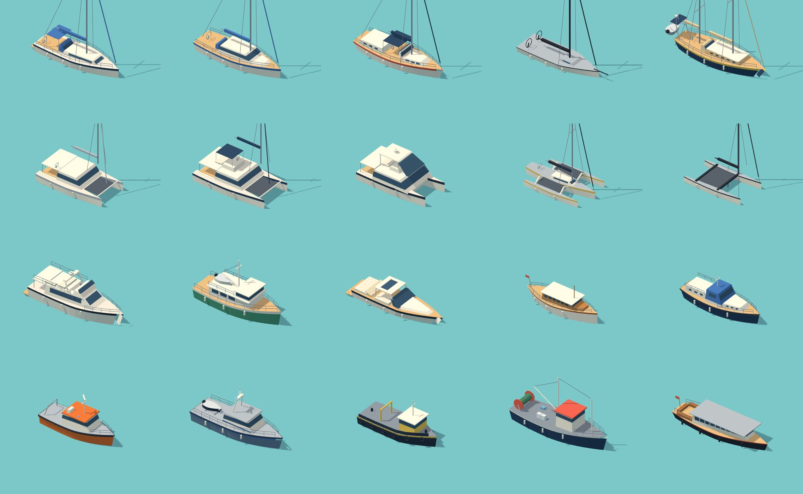
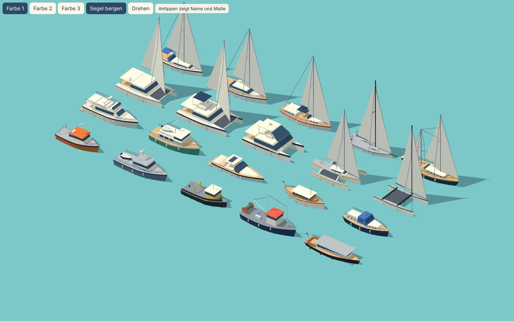

# Schiffe der Größe L

Stand: 11.11.2026. 4 Arten mit je 5 Modellen, 3 Farbvarianten je Modell. Status: gebaut. Daten in `web/js/data/boats/l.js`, Modelle in `web/js/render/boats/l.js`.



Mit gesetzten Segeln:



| Art | Modelle | Ab Stufe | Liegt an |
|---|---|---|---|
| L1 Fahrtenyacht | Moderne Serienyacht, Decksalonyacht, Mittelcockpit-Yacht, Regattayacht, Langfahrt-Ketsch | 3 | Box L, Fingerplatz L, Stirnplatz |
| L2 Mehrrumpfboot | Fahrtenkatamaran, Katamaran mit Flybridge, Motorkatamaran, Trimaran, Regatta-Katamaran | 4 | nur Stirnplatz |
| L3 Motoryacht | Flybridge-Yacht, Trawleryacht, Sportcruiser, Klassische Holzmotoryacht, Stahlyacht mit Achterkajüte | 3 | Box L, Fingerplatz L, Stirnplatz |
| L4 Arbeits- und Behördenboot | Seenotrettungsboot, Polizeiboot, Arbeitsboot, Großer Fischkutter, Hafenbarkasse | 4 | Box L, Fingerplatz L, Stirnplatz |

## Ansehen

```bash
python3 -m http.server 8000 --directory web
```

Danach `http://localhost:8000/vorschau/boote-l.html` öffnen. Knöpfe: Farbvariante, Segel setzen und bergen, Drehen. Antippen zeigt Name und Maße. Ein einzelnes Modell: `http://localhost:8000/vorschau/boote-l.html?id=L1-5`.

## Im Spiel verwenden

```js
const L = game.boatTypes.l;                       // von init(game) angemeldet
const boot = L.buildBoat('L1-3', { palette: 1, id: 'b17' });
game.scene.add(boot);
L.setSails(boot, true);                           // Segel setzen
```

Konvention wie bei M: 1 Einheit = 1 m, Bug nach +X, Ursprung Wasserlinie mittschiffs. Benannte Teile für das Animationsmodul: `hull`, `sail-main`, `sail-jib` (`userData.furl = 'x'`), `sail-mizzen`, `boom`, `boom-mizzen` (Drehpunkt am Mast), `cover-...`, `fender`, `flag`, `radar`, `cleat-bow`, `cleat-stern`. Feste Teile sind pro Farbe zu einem Mesh zusammengefasst, damit auch viele Boote auf dem Handy flüssig laufen. Windgenerator (L1-5) und Blaulichter (L4-1, L4-2) bewegt `init(game)` selbst.

Noch nicht im Spiel sichtbar: Die L-Boote erscheinen, sobald die Spielregeln Boote ab Stufe 3 einlaufen lassen.
