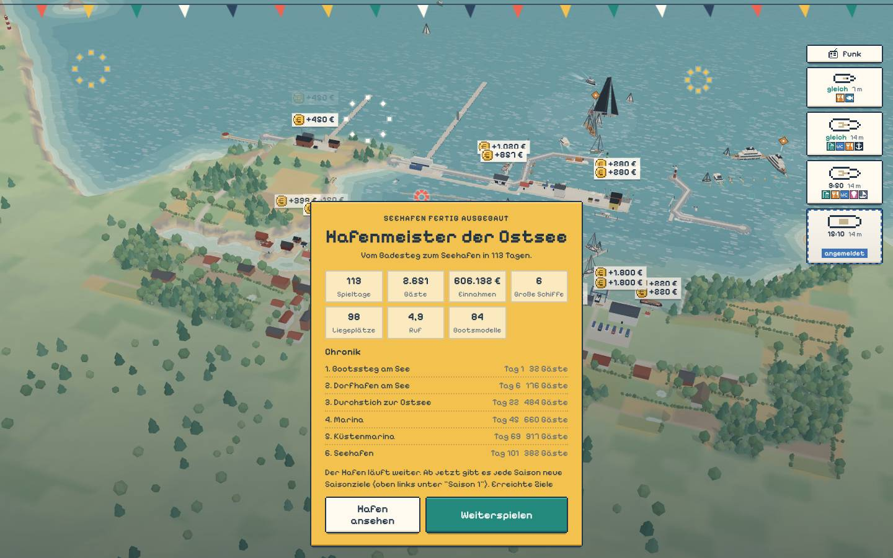

# Zusammenspiel prüfen (P85)

Jorvens Auftrag (14.11.2026): prüfen, ob im Zusammenspiel alles funktioniert, ob alle Features noch da sind, ob neue Features im Spiel wirklich vorkommen, ob alles aus Welle 1 wirklich behoben ist und ob etwas übersehen wurde. Drei Bereiche, je ein Abschnitt in dieser Datei (siehe [arbeitsplan.md](arbeitsplan.md), Abschnitt 3a):

1. Kernschleife und Regeln (dieser Abschnitt)
2. Oberfläche und Geräte (eigener Abschnitt des zweiten Threads)
3. Welt, Boote, Ereignisse (startet nach P66 und P84)

---

## 1. Kernschleife und Regeln

Stand: 20.11.2026, gemessen auf `main` bei `64cbe84` (nach PR 348).

### Wie gemessen wurde

Ein Zähllauf spielt das echte Spiel im Browser im Zeitraffer von Tag 1 bis zum Abschlussziel der Stufe 6 und zählt jedes Ereignis, das Regeln und Module melden (`game.emit`), samt Merkmalen. Beispiel: `sim:collected.hand=true` heißt "Münze von Hand eingestrichen", `sim:moored.paeckchen=ja` heißt "längsseits im Päckchen festgemacht". So steht für jede Regel da, wie oft sie in einem ganzen Spiel wirklich greift. Beim ersten Auftreten jeder wichtigen Regel entsteht ein Bild.

Zwei Spieler:

- **aktiv** spielt wie ein Mensch: weist drei von vier Booten an der Boje selbst zu (Wunschplatz zuerst, bei vollem Hafen ins Päckchen), lässt jedes vierte selbst einfahren, überlässt dem Hafenbüro, was es selbst zuweist, kassiert zwei von drei Münzen von Hand (den Rest holt der Rundgang), wählt jeden Morgen ein Tagesziel, hält für jede zweite Funk-Anmeldung eine Box frei, legt Gäste in eine bessere Box um, vergibt alle fünf Tage einen Dauerplatz, weist ab, wenn alle Bojen voll sind und nichts passt, und kauft alles über das Bauen-Menü (Vorschau, Knopf "Bauen für ...", Ausbau in Bauabschnitten, Nachrüsten, Doppelboxen).
- **passiv** ist der Zeitraffer-Bot: kassiert alles sofort, weist nie zu, kauft direkt über die Regeln. Er zeigt, was ohne Zutun des Spielers passiert.

Befehle (im Hauptordner, einmal vorher `cd tests && npm ci && cd ..`):

```bash
node tools/zusammenspiel/kernschleife.cjs --spieler aktiv --geraet pc --gelaende 2 --seed 11 --minuten 100 --out /tmp/zs/aktiv-pc-k2
node tools/zusammenspiel/kernschleife.cjs --spieler passiv --geraet pc --gelaende 13 --seed 7 --minuten 100 --out /tmp/zs/passiv-pc-k13
node tools/zusammenspiel/bericht.cjs /tmp/zs
```

Ein Lauf dauert im Container 11 bis 15 Minuten, zwei gleichzeitig gehen. Der Bericht steht dann in `/tmp/zs/bericht.md` (Regeln, Bojen je Stufe, Aktionen, Summen, alle Zähler). Optionen wie beim Zeitraffer: `--geraet pc|handy|handyquer|tablet`, `--tempo`, `--bis`, `--gelaende`, `--seed`, `--stegbild`, `--web`.

Läufe dieser Messung (alle Bilder und `ergebnis.json` unter `/mnt/project-files/zusammenspiel/2026-11-20-64cbe84/`):

| Lauf | Spieler | Gerät | Küste | Ziel Stufe 6 erreicht | Konsolenfehler |
|---|---|---|---|---|---|
| aktiv-pc-k2 | aktiv | PC | 2 Offene Bucht, Seed 11 | Tag 114 | 0 |
| aktiv-handy-k8 | aktiv | Handy | 8 Förde, Seed 22 | Tag 113 | 0 |
| passiv-pc-k13 | passiv | PC | 13 (echte Küste), Seed 7 | Tag 100 | 0 |
| passiv-pc-k2-alt | passiv | PC | 2 Offene Bucht, Seed 11, Stand `cd533e4` (15.11.) | Tag 103 | 0 |

Aufstieg (Tag): aktiv PC 6 / 22 / 45 / 69 / 101, aktiv Handy 6 / 21 / 44 / 68 / 100, passiv 6 / 17 / 39 / 62 / 88. Der aktive Spieler ist langsamer, weil er über das Bauen-Menü baut: Der Ausbau läuft dort in Bauabschnitten (P18), jeder über Nacht, und er kauft auch Nachrüsten und Angebote. Die Rechnung in `tools/balance.mjs` und der Zeitraffer überspringen die Bauabschnitte; ein echtes Spiel dauert darum rund 10 Spieltage länger als dort gerechnet.



### Welle 1 und 2 im laufenden Spiel

Zahlen: wie oft die Regel in einem ganzen Spiel gegriffen hat (aktiv PC / aktiv Handy / passiv Küste 13). "-" heißt: der passive Spieler handelt dort nie selbst, 0 ist erwartet.

| Paket | Punkt | Im Spiel gesehen | Anzahl | Ergebnis |
|---|---|---|---|---|
| P01 Ü1, Ü20 | Dauerplatz vergeben, Pacht | Dauerplatz vergeben; Pacht der Dauerlieger und Fischer | 17 / 17 / -; Pacht 195 / 194 / 170 | ja |
| P02 Ü2, Ü11 | Hafenbüro: Sonderfälle bleiben beim Spieler, Büro weist zu | Sonderfall ab Stufe 4; Spieler überlässt dem Büro 283 Boote (aktiv PC) | 172 / 210 / 151 | ja |
| P04 Ü4 | Großschiffbesuche zählen fürs Abschlussziel | Besuche; Ziel "6 große Schiffe" erreicht | 34 / 32 / 34 | ja |
| P05 Ü5 | Boote auf wegfallenden Plätzen | Umzug beim Ausbau (`grund: umbau`); Abreise wegen Umbau | 8 / 9 / 11; 0 / 1 / 0 | ja (Abreise ist der Randfall ohne Ersatzbox) |
| P06 Ü6, Ü24 | eine Quelle für Zahlen, Regeltests | nicht im Spiel sichtbar; `tests/regeln.mjs`, `node tools/zahlen.mjs` | - | über die Tests |
| P07 Ü7 | Tempo | Oberfläche, Bereich 2 | - | Bereich 2 |
| P08 | Doku | - | - | Bereich 2 |
| P09 Ü25 | Speichern und Laden | Zeitraffer prüft nach jedem Aufstieg und alle 40 Tage ([zeitraffer.md](zeitraffer.md)) | - | dort |
| P10 Ü8 | Selbst-Einfahren nach 8 s | an der Boje; direkt, wenn alle Bojen voll | 473 / 512 / 1069; direkt 95 / 150 / 156 | ja |
| P10 | Zuweisen von Hand | festgemacht mit `hand` | 531 / 510 / - | ja |
| P10 Ü9 | Wunschplätze | Spieler wählt Wunschplatz (gold) 66-mal; Liegegeld mit mindestens einem erfüllten Platz-Wunsch | 795 / 809 / 740 | ja |
| P10 Ü13 | Abweisen und Wegfahren | abgewiesen; weggefahren (Geduld, Bojen voll, spät) | 29 / 24 / -; 779 / 731 / 578 | ja |
| P11 Ü10 | Wünsche über dem Boot, Vorschau | Ankunftsvorschau und Funk-Anmeldung | angemeldet 93 / 93 / 80 | ja |
| Liegegeld | Liegegeld beim Festmachen, Bändchen | fällig beim Festmachen | 3193 / 3271 / 2992 | ja |
| P12 Ü12, B5 | Kassieren, Rundgang, Trinkgeld | von Hand; Rundgang am Abend; Trinkgeld großer Boote | 725 / 743 / 1094; 357 / 401 / -; 18.146 € / 17.678 € / 25.134 € | ja |
| B | Ehrlichkeitskasse, Bojengeld | Kasse für Kurzhalter am Abend; Bojengeld | 168 / 172 / -; 74 / 80 / 69 | ja |
| P13 Ü14 | Tagesziele, Wochenziele | gewählt; erreicht; Wochenziel erreicht | 102 / 101 / -; 61 / 54 / -; 10 / 8 / 12 | ja |
| P14 Ü21 | Bewertung im Gästebuch | Bewertungsblase | 2550 / 2521 / 2234 | ja |
| P15 Ü22 | Tagesabschluss | Bericht an jedem der rund 100 Tagesenden; Karte oder Zettel gesehen | ja (Bild) | ja, siehe Hinweis 4 |
| P16 Ü23 | Aufstieg und Abschluss feiern | 5 Aufstiege mit Feier, Abschluss "Hafenmeister der Ostsee" | 5 / 5 / 5; 1 / 1 / 1 | ja |
| P17 Ü15, Ü16 | Start und Takt | geschenktes WC beim ersten Bauen (`bauen:geschenk`), Stufe 1 in 6 Tagen | 1 / 1 / - | ja |
| P18 Ü18 | Ausbau in Bauabschnitten | beauftragt; fertig über Nacht; alles über das Bauen-Menü | 10 / 10 / -; 6 / 6 / -; 98 / 98 / - | ja |
| P19 Ü17 | Ruf, Auszeichnung | Auszeichnung steigt; sinkt | 5 / 5 / 3; 2 / 2 / 0 | ja |
| P20 Ü19 | Winter | Winterpause mit Karte, rund 6 Winter je Spiel | 6 / 6 / 7 | ja (G5 und H5-Rest offen, P20-Rest) |
| P21 | Logbuch | neue Einträge | 81 / 84 / 81 | ja |
| P22 | Erfolge | erreicht in einem Spiel | 28 / 28 / 27 | ja |

Weitere Features der Kernschleife, die neu dazukamen, kommen in einem normalen Spiel alle vor:

| Feature | Anzahl (aktiv PC / aktiv Handy / passiv) |
|---|---|
| Kurzhalter (Liegegeld ohne Nacht, P86) | 1005 / 1022 / 904 |
| Tagestörn der Gäste | 734 / 752 / 722 |
| Päckchen längsseits (P27) | 62 / 65 / - |
| Umlegen von Hand (P33) | 5 / 6 / - |
| Funk: Box freigehalten und genutzt (P28) | 69 und 69 / 67 und 67 / - |
| Steg nachgerüstet (P30) | 11 / 11 / - |
| Ereignisse (P24) | 42 / 42 / 36 |
| Bootsgeschichten (P86) | 63 / 62 / 60 |

Nicht von den Läufen erreicht, weil der Spieler-Bot es nicht macht: Trinkgeld beim langen Wischen über Münzen (`sim:strokeTip`, Geste, geprüft in `tests/specs/`).


### Funde

| Nr | Prio | Fund | Beleg | Was passiert |
|---|---|---|---|---|
| K1 | B | **Bojen ab Stufe 4 oft schon belegt, bevor jemand dort ankommt.** Die Warteplätze zählen ab der Ankunft weit draußen; mit der langen Anreise sind sie die meiste Zeit von Booten auf der Anfahrt belegt. Neue Boote fahren dann direkt in eine Box oder drehen ab, ohne je zu sehen zu sein. | Stand 15.11. (`cd533e4`), passiv: Stufe 5 nur 39 von 860 Ankünften an einer Boje, 472 direkt, 242 abgedreht; Stufe 6 3 von 438. Probe `?stufe=5` auf `64cbe84`: 12 Proben über 8 Tage, jedes Mal 8 von 8 Warteplätzen belegt, 0 bis 1 Boot an der Boje. Auf `64cbe84` im ganzen Spiel milder: Stufe 5 an der Boje 194 bis 303 von rund 1000, abgedreht 73 bis 137. | an "Staus an Bojen und Ankerfeld auflösen" (P66) gemeldet; `sim.js` dort nicht selbst geändert |
| K2 | B | **Jeder zufriedene Gast wird Stammgast.** `stammgaeste.abBewertung` ist 4, aber neun von zehn Abreisen bekommen 4,5 oder 5 Anker. So gibt es rund 1500 "neue Stammgäste" je Spiel, die Liste (höchstens 40) wechselt ständig, und der Erfolg "25 Stammgäste" ist kein Ziel mehr. | `stammgast:neu` 1564 / 1611 / 1435 je Spiel; Notenverteilung `sim:departed.note` | Vorschlag: `abBewertung: 5` oder Stammgast erst ab dem zweiten Besuch. Zahl in `economy.js`, darum über den Services-Thread (einziger an `economy.js`) |
| K3 | C | **`einstieg:ende` kam nach dem Einstieg bei jedem Anlegen und Kassieren erneut** (rund 6000-mal je Spiel), und jedes Mal rechnete das Bauen-Menü den Tipp "Als Nächstes" neu. | Zähler `einstieg:ende` 53 / 379 / 1080 / 1468 / 2025 / 961 je Stufe | behoben in diesem PR (`features/einstieg.js`: nur beim Übergang zu "fertig") |
| K4 | C | Rechnung und Zeitraffer kennen die Bauabschnitte nicht: Ein Spieler, der über das Bauen-Menü baut, erreicht das Ziel rund 10 Spieltage später (Tag 113 statt 100 bis 103). | Aufstiegstage oben | Hinweis für das Balancing (`tools/balance.mjs`), kein Fehler im Spiel |
| K5 | C | Doppelbox und Rückbau stehen dauerhaft im Bauen-Menü; wer beides abwechselnd kauft, zahlt jedes Mal (990 € und Rückbau). Ein Mensch tut das kaum, aber "Rückbau" steht auch dann da, wenn gerade niemand eine Einzelbox braucht. | erster Lauf des aktiven Spielers: 15 Umbauten und 14 Rückbauten | notiert, für Bereich 2 (Bauen-Menü) |

Hinweise zur Messung:

1. Ereignisse, die nur der aktive Spieler auslöst (Zuweisen von Hand, Päckchen, Umlegen, Funk, Dauerplatz, Tagesziele), kommen beim passiven Spieler nicht vor; das ist erwartet.
2. Die Ehrlichkeitskasse greift nur, wenn Münzen liegen bleiben. Der passive Spieler kassiert alles sofort, darum dort 0.
3. Die Bilder "beim ersten Auftreten" entstehen beim nächsten Abfragen (bis 0,7 s Echtzeit, bei Tempo 500 einige Spielminuten später). Sie zeigen den Hafen kurz nach der Regel, nicht immer den Augenblick selbst.
4. Tagesabschluss-Karte und -Zettel bleiben in echter Zeit stehen (Sekunden). Bei Tempo 500 läuft in dieser Zeit ein ganzer Spieltag, darum meldet der Zettel nur selten "fertig". Das ist eine Eigenheit des Zeitraffers, im Spiel bei 1x bis 8x nicht.
