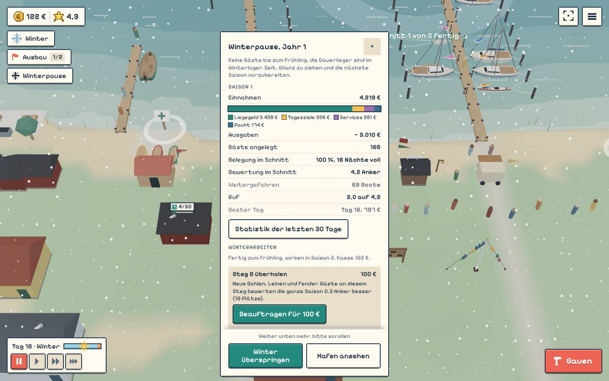
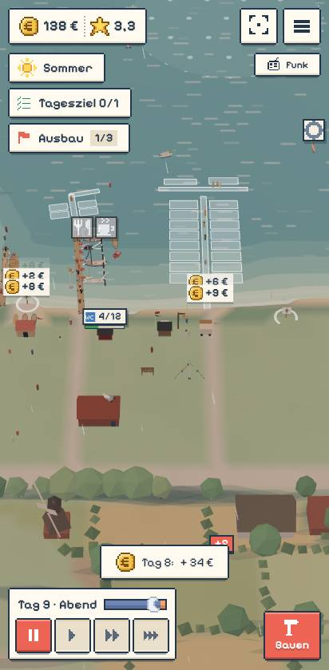
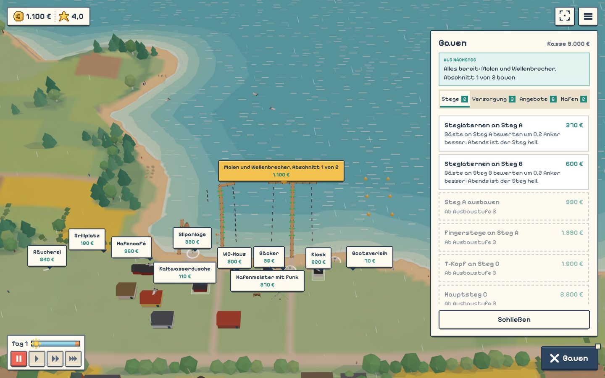

# Zusammenspiel nach Welle 0 (P85)

Jorvens Auftrag vom 14.11.2026: Prüfen, ob alles im Zusammenspiel funktioniert, ob alle Features noch da sind, ob neue Features im Spiel wirklich genutzt werden, ob alles aus Welle 1 wirklich gefixt ist und ob etwas übersehen wurde. Drei Threads, je Bereich ein Abschnitt in dieser Datei ([Arbeitsplan Abschnitt 3a](arbeitsplan.md)).

## Kernschleife und Regeln (Zusammenspiel 1)

Stand: 20.11.2026, gemessen auf `main` bei `64cbe84` (nach PR 348).

### Wie gemessen wurde

Ein Zähllauf spielt das echte Spiel im Browser im Zeitraffer von Tag 1 bis zum Abschlussziel der Stufe 6 und zählt jedes Ereignis, das Regeln und Module melden (`game.emit`), samt Merkmalen. Beispiel: `sim:collected.hand=true` heißt "Münze von Hand eingestrichen", `sim:moored.paeckchen=ja` heißt "längsseits im Päckchen festgemacht". So steht für jede Regel da, wie oft sie in einem ganzen Spiel wirklich greift. Beim ersten Auftreten jeder wichtigen Regel entsteht ein Bild.

Zwei Spieler:

- **aktiv** spielt wie ein Mensch: weist drei von vier Booten an der Boje selbst zu (Wunschplatz zuerst, bei vollem Hafen ins Päckchen), lässt jedes vierte selbst einfahren, überlässt dem Hafenbüro, was es selbst zuweist, kassiert zwei von drei Münzen von Hand (den Rest holt der Rundgang), wählt jeden Morgen ein Tagesziel, hält für jede zweite Funk-Anmeldung eine Box frei, legt Gäste in eine bessere Box um, vergibt alle fünf Tage einen Dauerplatz, weist ab, wenn alle Bojen voll sind und nichts passt, und kauft alles über das Bauen-Menü (Vorschau, Knopf "Bauen für ...", Ausbau in Bauabschnitten, Nachrüsten, Doppelboxen).
- **passiv** ist der Zeitraffer-Bot: kassiert alles sofort, weist nie zu, kauft direkt über die Regeln. Er zeigt, was ohne Zutun des Spielers passiert.

Befehle (im Hauptordner, einmal vorher `cd tests && npm ci && cd ..`):

```bash
node tools/zusammenspiel/kernschleife.cjs --spieler aktiv --geraet pc --gelaende 2 --seed 11 --minuten 100 --out /tmp/zs/aktiv-pc-k2
node tools/zusammenspiel/kernschleife.cjs --spieler passiv --geraet pc --gelaende 13 --seed 7 --minuten 100 --out /tmp/zs/passiv-pc-k13
node tools/zusammenspiel/bericht.cjs /tmp/zs
```

Ein Lauf dauert im Container 11 bis 15 Minuten, zwei gleichzeitig gehen. Der Bericht steht dann in `/tmp/zs/bericht.md` (Regeln, Bojen je Stufe, Aktionen, Summen, alle Zähler). Optionen wie beim Zeitraffer: `--geraet pc|handy|handyquer|tablet`, `--tempo`, `--bis`, `--gelaende`, `--seed`, `--stegbild`, `--web`.

Läufe dieser Messung (alle Bilder und `ergebnis.json` unter `/mnt/project-files/zusammenspiel/2026-11-20-64cbe84/`):

| Lauf | Spieler | Gerät | Küste | Ziel Stufe 6 erreicht | Konsolenfehler |
|---|---|---|---|---|---|
| aktiv-pc-k2 | aktiv | PC | 2 Offene Bucht, Seed 11 | Tag 114 | 0 |
| aktiv-handy-k8 | aktiv | Handy | 8 Förde, Seed 22 | Tag 113 | 0 |
| passiv-pc-k13 | passiv | PC | 13 (echte Küste), Seed 7 | Tag 100 | 0 |
| passiv-pc-k2-alt | passiv | PC | 2 Offene Bucht, Seed 11, Stand `cd533e4` (15.11.) | Tag 103 | 0 |

Aufstieg (Tag): aktiv PC 6 / 22 / 45 / 69 / 101, aktiv Handy 6 / 21 / 44 / 68 / 100, passiv 6 / 17 / 39 / 62 / 88. Der aktive Spieler ist langsamer, weil er über das Bauen-Menü baut: Der Ausbau läuft dort in Bauabschnitten (P18), jeder über Nacht, und er kauft auch Nachrüsten und Angebote. Die Rechnung in `tools/balance.mjs` und der Zeitraffer überspringen die Bauabschnitte; ein echtes Spiel dauert darum rund 10 Spieltage länger als dort gerechnet.


### Welle 1 und 2 im laufenden Spiel

Zahlen: wie oft die Regel in einem ganzen Spiel gegriffen hat (aktiv PC / aktiv Handy / passiv Küste 13). "-" heißt: der passive Spieler handelt dort nie selbst, 0 ist erwartet.

| Paket | Punkt | Im Spiel gesehen | Anzahl | Ergebnis |
|---|---|---|---|---|
| P01 Ü1, Ü20 | Dauerplatz vergeben, Pacht | Dauerplatz vergeben; Pacht der Dauerlieger und Fischer | 17 / 17 / -; Pacht 195 / 194 / 170 | ja |
| P02 Ü2, Ü11 | Hafenbüro: Sonderfälle bleiben beim Spieler, Büro weist zu | Sonderfall ab Stufe 4; Spieler überlässt dem Büro 283 Boote (aktiv PC) | 172 / 210 / 151 | ja |
| P04 Ü4 | Großschiffbesuche zählen fürs Abschlussziel | Besuche; Ziel "6 große Schiffe" erreicht | 34 / 32 / 34 | ja |
| P05 Ü5 | Boote auf wegfallenden Plätzen | Umzug beim Ausbau (`grund: umbau`); Abreise wegen Umbau | 8 / 9 / 11; 0 / 1 / 0 | ja (Abreise ist der Randfall ohne Ersatzbox) |
| P06 Ü6, Ü24 | eine Quelle für Zahlen, Regeltests | nicht im Spiel sichtbar; `tests/regeln.mjs`, `node tools/zahlen.mjs` | - | über die Tests |
| P07 Ü7 | Tempo | Oberfläche, Bereich 2 | - | Bereich 2 |
| P08 | Doku | - | - | Bereich 2 |
| P09 Ü25 | Speichern und Laden | Zeitraffer prüft nach jedem Aufstieg und alle 40 Tage ([zeitraffer.md](zeitraffer.md)) | - | dort |
| P10 Ü8 | Selbst-Einfahren nach 8 s | an der Boje; direkt, wenn alle Bojen voll | 473 / 512 / 1069; direkt 95 / 150 / 156 | ja |
| P10 | Zuweisen von Hand | festgemacht mit `hand` | 531 / 510 / - | ja |
| P10 Ü9 | Wunschplätze | Spieler wählt Wunschplatz (gold) 66-mal; Liegegeld mit mindestens einem erfüllten Platz-Wunsch | 795 / 809 / 740 | ja |
| P10 Ü13 | Abweisen und Wegfahren | abgewiesen; weggefahren (Geduld, Bojen voll, spät) | 29 / 24 / -; 779 / 731 / 578 | ja |
| P11 Ü10 | Wünsche über dem Boot, Vorschau | Ankunftsvorschau und Funk-Anmeldung | angemeldet 93 / 93 / 80 | ja |
| Liegegeld | Liegegeld beim Festmachen, Bändchen | fällig beim Festmachen | 3193 / 3271 / 2992 | ja |
| P12 Ü12, B5 | Kassieren, Rundgang, Trinkgeld | von Hand; Rundgang am Abend; Trinkgeld großer Boote | 725 / 743 / 1094; 357 / 401 / -; 18.146 € / 17.678 € / 25.134 € | ja |
| B | Ehrlichkeitskasse, Bojengeld | Kasse für Kurzhalter am Abend; Bojengeld | 168 / 172 / -; 74 / 80 / 69 | ja |
| P13 Ü14 | Tagesziele, Wochenziele | gewählt; erreicht; Wochenziel erreicht | 102 / 101 / -; 61 / 54 / -; 10 / 8 / 12 | ja |
| P14 Ü21 | Bewertung im Gästebuch | Bewertungsblase | 2550 / 2521 / 2234 | ja |
| P15 Ü22 | Tagesabschluss | Bericht an jedem der rund 100 Tagesenden; Karte oder Zettel gesehen | ja (Bild) | ja, siehe Hinweis 4 |
| P16 Ü23 | Aufstieg und Abschluss feiern | 5 Aufstiege mit Feier, Abschluss "Hafenmeister der Ostsee" | 5 / 5 / 5; 1 / 1 / 1 | ja |
| P17 Ü15, Ü16 | Start und Takt | geschenktes WC beim ersten Bauen (`bauen:geschenk`), Stufe 1 in 6 Tagen | 1 / 1 / - | ja |
| P18 Ü18 | Ausbau in Bauabschnitten | beauftragt; fertig über Nacht; alles über das Bauen-Menü | 10 / 10 / -; 6 / 6 / -; 98 / 98 / - | ja |
| P19 Ü17 | Ruf, Auszeichnung | Auszeichnung steigt; sinkt | 5 / 5 / 3; 2 / 2 / 0 | ja |
| P20 Ü19 | Winter | Winterpause mit Karte, rund 6 Winter je Spiel | 6 / 6 / 7 | ja (G5 und H5-Rest offen, P20-Rest) |
| P21 | Logbuch | neue Einträge | 81 / 84 / 81 | ja |
| P22 | Erfolge | erreicht in einem Spiel | 28 / 28 / 27 | ja |

Weitere Features der Kernschleife, die neu dazukamen, kommen in einem normalen Spiel alle vor:

| Feature | Anzahl (aktiv PC / aktiv Handy / passiv) |
|---|---|
| Kurzhalter (Liegegeld ohne Nacht, P86) | 1005 / 1022 / 904 |
| Tagestörn der Gäste | 734 / 752 / 722 |
| Päckchen längsseits (P27) | 62 / 65 / - |
| Umlegen von Hand (P33) | 5 / 6 / - |
| Funk: Box freigehalten und genutzt (P28) | 69 und 69 / 67 und 67 / - |
| Steg nachgerüstet (P30) | 11 / 11 / - |
| Ereignisse (P24) | 42 / 42 / 36 |
| Bootsgeschichten (P86) | 63 / 62 / 60 |

Nicht von den Läufen erreicht, weil der Spieler-Bot es nicht macht: Trinkgeld beim langen Wischen über Münzen (`sim:strokeTip`, Geste, geprüft in `tests/specs/`).





### Funde

| Nr | Prio | Fund | Beleg | Was passiert |
|---|---|---|---|---|
| K1 | B | **Bojen ab Stufe 4 oft schon belegt, bevor jemand dort ankommt.** Die Warteplätze zählen ab der Ankunft weit draußen; mit der langen Anreise sind sie die meiste Zeit von Booten auf der Anfahrt belegt. Neue Boote fahren dann direkt in eine Box oder drehen ab, ohne je zu sehen zu sein. | Stand 15.11. (`cd533e4`), passiv: Stufe 5 nur 39 von 860 Ankünften an einer Boje, 472 direkt, 242 abgedreht; Stufe 6 3 von 438. Probe `?stufe=5` auf `64cbe84`: 12 Proben über 8 Tage, jedes Mal 8 von 8 Warteplätzen belegt, 0 bis 1 Boot an der Boje. Auf `64cbe84` im ganzen Spiel milder: Stufe 5 an der Boje 194 bis 303 von rund 1000, abgedreht 73 bis 137. | an "Staus an Bojen und Ankerfeld auflösen" (P66) gemeldet; `sim.js` dort nicht selbst geändert |
| K2 | B | **Jeder zufriedene Gast wird Stammgast.** `stammgaeste.abBewertung` ist 4, aber neun von zehn Abreisen bekommen 4,5 oder 5 Anker. So gibt es rund 1500 "neue Stammgäste" je Spiel, die Liste (höchstens 40) wechselt ständig, und der Erfolg "25 Stammgäste" ist kein Ziel mehr. | `stammgast:neu` 1564 / 1611 / 1435 je Spiel; Notenverteilung `sim:departed.note` | Vorschlag: `abBewertung: 5` oder Stammgast erst ab dem zweiten Besuch. Zahl in `economy.js`, darum über den Services-Thread (einziger an `economy.js`) |
| K3 | C | **`einstieg:ende` kam nach dem Einstieg bei jedem Anlegen und Kassieren erneut** (rund 6000-mal je Spiel), und jedes Mal rechnete das Bauen-Menü den Tipp "Als Nächstes" neu. | Zähler `einstieg:ende` 53 / 379 / 1080 / 1468 / 2025 / 961 je Stufe | behoben in diesem PR (`features/einstieg.js`: nur beim Übergang zu "fertig") |
| K4 | C | Rechnung und Zeitraffer kennen die Bauabschnitte nicht: Ein Spieler, der über das Bauen-Menü baut, erreicht das Ziel rund 10 Spieltage später (Tag 113 statt 100 bis 103). | Aufstiegstage oben | Hinweis für das Balancing (`tools/balance.mjs`), kein Fehler im Spiel |
| K5 | C | Doppelbox und Rückbau standen dauerhaft im Bauen-Menü; wer beides abwechselnd kaufte, zahlte jedes Mal (990 € und Rückbau). | erster Lauf des aktiven Spielers: 15 Umbauten und 14 Rückbauten | erledigt (PR 356): Doppelbox nur, solange am Steg keine freie Doppelbox steht; Rückbau nur, wenn eine Doppelbox frei ist und alle schmalen Boxen belegt sind |

Hinweise zur Messung:

1. Ereignisse, die nur der aktive Spieler auslöst (Zuweisen von Hand, Päckchen, Umlegen, Funk, Dauerplatz, Tagesziele), kommen beim passiven Spieler nicht vor; das ist erwartet.
2. Die Ehrlichkeitskasse greift nur, wenn Münzen liegen bleiben. Der passive Spieler kassiert alles sofort, darum dort 0.
3. Die Bilder "beim ersten Auftreten" entstehen beim nächsten Abfragen (bis 0,7 s Echtzeit, bei Tempo 500 einige Spielminuten später). Sie zeigen den Hafen kurz nach der Regel, nicht immer den Augenblick selbst.
4. Tagesabschluss-Karte und -Zettel bleiben in echter Zeit stehen (Sekunden). Bei Tempo 500 läuft in dieser Zeit ein ganzer Spieltag, darum meldet der Zettel nur selten "fertig". Das ist eine Eigenheit des Zeitraffers, im Spiel bei 1x bis 8x nicht.

---

## Oberfläche und Geräte (Zusammenspiel 2)

Stand 20.11.2026 (Nachfunde F4 am selben Abend, F6 am 21.11.), Thread "Zusammenspiel prüfen: Oberfläche und Geräte". Geprüft auf `main` nach PR 345, im laufenden Spiel (`?stufe=3&seed=7`, Ostsee, Tag 1) auf fünf Geräten: iPhone 13 hochkant (390 x 664) und quer (750 x 342), Galaxy Tab S4 hochkant (712 x 1138) und quer, PC 1440 x 900.

### Wie geprüft wurde

| Prüfung | Werkzeug | Umfang |
|---|---|---|
| Jede Taste drücken, bis drei Ebenen tief (Taste, was sie öffnet, was darin steht), je Weg ein Bild | `node tools/zusammenspiel/oberflaeche.cjs <ordner> <gerät>` | Handy hoch 86 Wege, Handy quer 86, Tablet hoch 81, PC 70. Gleichartige Tasten (Listenzeilen, Bauplätze) zweimal je Art. Gesperrt: alles, was den Spielstand löscht oder die Seite verlässt |
| Bei jedem Weg: Taste verdeckt (3 von 5 Punkten unter etwas anderem), ragt aus dem Bild, am Touchgerät kleiner als 40 px, Schrift nicht Pixelify Sans, Text unter 11 px | dasselbe Werkzeug, `bericht.json` | alle sichtbaren Tasten und Texte |
| Jede Taste aus der PC-Tastenhilfe (`?`) einmal drücken und prüfen, ob passiert, was dort steht | `node tools/zusammenspiel/tasten.cjs` | 40 Tasten |
| Verdeckte Spielfläche je Gerät und Lage | `node tools/zusammenspiel/bilder.cjs <ordner>` (Raster aus `tools/verdeckung/`) | 7 Lagen x 5 Geräte, Bilder in doppelter Auflösung |
| Texte in Hilfe, Einstieg, Bauen-Rat und Tastenhilfe gegen den Code | von Hand | alle Sätze, die eine Taste, ein Tempo oder eine Regel versprechen |

Server für alle Werkzeuge: `bash tools/build-pages.sh && (cd tests && node server.mjs 4180)`.

### Ergebnis

- **Schrift:** Kein einziger sichtbarer Text auf keinem Gerät ist nicht Pixelify Sans, auch nicht Ziffern und Euro. Keine Texte unter 11 px (nur unsichtbare Vorlesetexte mit 0 px).
- **PC-Tasten:** Alle 40 Tasten der Tastenhilfe wirken wie beschrieben (F, G, Leertaste, B, N, J, T, M, P, L, ?, F1, Esc, Q, E, R, V, Bild auf/ab, +, -, W A S D, Pfeile, 0, Pos1, 1 bis 9, Tab, Enter). W und Pfeil links bewegen am Kartenrand nichts, weil die Kamera dort schon an der Grenze steht; das ist gewollt.
- **Verdeckt:** Wichtige Tasten werden nur von Tafeln verdeckt, die der Spieler selbst geöffnet hat und die ein Schließen-Kreuz haben (Logbuch, Gästebuch, Hilfe, Einstellungen, Statistik). Keine schwebende Meldung liegt über Zeit, Bauen, Geld oder Menü.
- **Kein Text zu etwas, das es nicht gibt:** Zwei Sätze in der Hilfe stimmten nicht mehr (Funde 1 und 2), sonst passt jeder geprüfte Satz zu dem, was im Spiel passiert.
- **Alle Oberflächen-Features noch da:** Meldeplatz, Einstieg (6 Schritte), Hilfe, Einstellungen (5 Schalter), Tempo (Pause, 1x, 3x, 8x), Bauen mit Reitern, Vorschau, Bestätigung und Rückgängig, Logbuch mit Booten, Chronik, Erfolgen, Geschichten, Gästebuch über den Ruf, Fotomodus mit "Bild sichern" und "Rundflug", Ton-Fenster mit vier Reglern, Spielstand, Statistik, Tagesabschluss mit Blättern, Tagesziele mit drei Karten, Stufenziel mit "Im Baumenü ansehen", Wetter mit Vorhersage. Jedes öffnet sich auf jedem Gerät und lässt sich wieder schließen.
- **Offline-Start:** abgedeckt durch die bestehenden Tests `tests/offline.test.mjs` und `tests/specs/offline.spec.mjs` (laufen in `bash tests/pruefen.sh`).

### Funde und was damit passiert ist

| Nr | Fund | Gerät | Behoben |
|---|---|---|---|
| 1 | Hilfe "Zeit": "Kommt ein Boot an die Boje, schaltet 8x von selbst zurück." Seit Jorvens Entscheidung vom 14.11. bremst nichts mehr automatisch | alle | Text sagt jetzt: Das Tempo bleibt, bis du selbst ein anderes wählst; nur Bauen und Spielstand halten die Zeit kurz an. Am PC zusätzlich G für 8x und die Leertaste (`features/hilfe.js`) |
| 2 | Hilfe "Tagesziele": "Links stehen drei kleine Ziele, die etwas Geld bringen". Tatsächlich wählt man eins von drei, und die Belohnung ist Geld, Bau-Gutschein, Deko oder Ruf | alle | Text an das Spiel angepasst |
| 3 | Logbuch: Die vier Reiter (Boote, Chronik, Erfolge, Geschichten) passen hochkant nicht in eine Zeile; der vierte war halb unter dem Schließen-Kreuz, ohne Hinweis, dass man seitlich schieben kann | Handy hoch | Reiter brechen hochkant in eine zweite Zeile um (`css/logbuch.css`) |
| 4 | Baumenü am Tablet hochkant fast bildschirmhoch (bis 927 von 1138 px): Bauplätze und Preisschilder waren nicht zu sehen | Tablet hoch | höchstens halbe Bildhöhe wie am Handy; Hafen und Schilder bleiben darüber sichtbar (`css/oberflaeche.css`) |
| 5 | Ruf (öffnet das Gästebuch) nur 25 px hoch | Handy, Tablet | Trefferfläche reicht am Touchgerät über das ganze Statusschild (`css/gaestebuch.css`) |
| 6 | Bauplätze als Punkt (wenn für ein Schild kein Platz ist) nur 22 x 22 px | Handy, Tablet | sieht gleich aus, nimmt den Finger aber auf 40 px an (`css/oberflaeche.css`, `ui/bauen.js`) |
| 7 | Tagesabschluss: Blättern-Pfeile 34 x 34 px | Handy hoch und quer, Tablet 36 px | 40 x 40 (`css/tagesabschluss.css`) |
| 8 | Einstellungen "Boote fahren selbst ein": Normal, Langsam, Nie 36 px hoch | Handy | 40 px (`css/oberflaeche.css`) |
| 9 | Baumenü: Reiter 38 px, "Rückgängig (10 s)" 32 px, Zeilen quer 36 px | Handy, Tablet, quer | Reiter 40, Rückgängig 40 (man hat nur 10 s), Zeilen quer 40 (`ui/bauen.js`, `css/ui-phone.css`) |
| 10 | Statistik am ersten Tag: zwei große leere gelbe Kästen ohne Erklärung | alle | Ein Satz, bis die ersten Boote zahlen (`ui/statistik.js`) |
| 11 | Tagesziel-Karten trennen kurze Wörter ("Wunsch Es-sen") | Handy | Silbentrennung erst ab Wörtern mit 8 Buchstaben (`features/tagesziele.js`) |
| 12 | Doku `ui/oberflaeche.md`: Menü-Liste ohne Tagesabschluss, Statistik, Hilfe, Einstellungen, Gästebuch, Logbuch; Tastenliste ohne G, K, N, J, T, R, V; Satz "Ziffern bleiben in der Systemschrift" (seit PR 282 falsch) | Doku | nachgezogen |
| 13 | Nachfund aus dem Schichttest (F4, 20.11.): Die Funk-Liste rechts lag über den Wartebojen am Kartenrand, ein wartendes Boot ließ sich in der Übersicht nicht antippen | Tablet quer (alle Geräte möglich) | Liegt ein wartendes Boot unter der Liste, wird sie durchlässig: blass, Tipps gehen hindurch zum Boot, der Kopf "Funk" bleibt bedienbar. Nachgemessen: Tipp auf das Boot unter der Liste trifft jetzt das Spiel (`ui/vorschau.js`, Bild `zusammenspiel/oberflaeche/f4-tabletquer-funk-durchlaessig.png`) |
| 14 | Nachfund aus dem Schichttest (F6, 21.11.): Am Handy hochkant (Pixel 7) lag die Funk-Anmeldung halb über der Zeitsteuerung, und der Knopf "Einfahren" ragte rechts aus dem Bild, wenn das Boot am Rand wartete | Handy hoch | Der Knopf "Einfahren" bleibt immer ganz im Bild, mindestens 8 px vom Rand; liegt das Boot ganz oben, steht er darunter (`ui/gesten.js`). Ragte er hinaus, wurde die Seite breiter, das Handy zoomte heraus und die Zeitsteuerung rutschte unter die Meldung (im Schichttest: Seite 431 x 878 statt 412 x 839, Zeit bei 809 bis 855). Zusätzlich rechnet der Meldeplatz die Zeitsteuerung auch dann mit, wenn sie hinter einer offenen Tafel links kurz versteckt ist, damit die Meldung beim Schließen nicht auf Pause und Tempo steht (`ui/meldungen.js`). Nachgemessen am Pixel 7: Knopf am rechten Rand 289 bis 404 von 412, am linken 8 bis 123; Meldung endet bei 728, Zeitsteuerung beginnt bei 736, alle vier Zeitknöpfe frei antippbar |

Bewusst so gelassen (kein Fund):

- Reiter im Baumenü quer 36 px und Knöpfe im Einstiegs-Tipp quer 36 px: Am Handy quer sind nur 342 px Höhe; 40 px würden die Liste um eine Zeile kürzen. Beide sind breit genug (über 60 px), der Finger trifft sie.
- Säulen der Statistik und Zeilen der Tagesabschluss-Chronik (22 bis 29 px hoch): Listen, die über die ganze Breite gehen; man tippt sie nur zum Nachlesen.
- Ein Boot im Einstieg wartet anfangs noch draußen, bevor es an der Boje ist; der Kreis folgt ihm. Der Einstieg selbst ist mit `tests/specs/einstieg.spec.mjs` abgedeckt (jedes Hinweisziel existiert, kein Text zu Gelöschtem).

Gemeldet statt selbst behoben: nichts. Zu Booten und Wegen ist bei dieser Prüfung nichts aufgefallen, was nicht schon P66 oder P84 ist.

### Verdeckte Spielfläche je Gerät

Anteil der Bildfläche in Prozent, an dem nicht der Hafen zu sehen ist (Raster 6 px, wie [ui/verdeckung.md](ui/verdeckung.md)), nach den Fixes:

| Lage | Handy hoch | Handy quer | Tablet hoch | Tablet quer | PC |
|---|---|---|---|---|---|
| Grundansicht | 29,6 | 27,9 | 12,2 | 12,2 | 6,3 |
| Menü offen | 65,8 | 65,3 | 27,6 | 27,6 | 16,2 |
| Bauen | 67,2 | 62,6 | 51,4 | 39,3 | 31,3 |
| Logbuch (Vollbild-Tafel mit Abdunklung) | 100 | 100 | 100 | 100 | 100 |
| Hilfe | 79 | 65,4 | 72,5 | 57,3 | 43,3 |
| Einstellungen | 80 | 72,6 | 42,7 | 38,3 | 22 |
| Tagesziel-Wahl | 50,4 | 53,1 | 24,3 | 25 | 13,7 |

Die Grundansicht liegt am Handy bei 30 und 28 %, wie nach PR 261 und 282 (32 und 30 %). Bauen am Tablet hochkant fiel durch Fund 4 von fast ganz bedeckt auf 51 %. Logbuch, Hilfe und Einstellungen sind Tafeln, die man selbst öffnet und mit einem Tipp schließt; sie dürfen viel verdecken.

### Bilder

Alle Bilder liegen in den Projektdateien unter `zusammenspiel/oberflaeche/`: je Gerät Grundansicht, Menü, Bauen, Logbuch, Hilfe, Einstellungen, Tagesziel-Wahl (`<gerät>-<lage>.png`), dazu die Bilder aller gedrückten Wege (`wege/<gerät>/`, Liste in `wege/<gerät>/bericht.json`).

---

## Ausbauten je Küste (Zusammenspiel 3, Teil 1)

Stand 21.11.2026, Thread "Unnötige Ausbauten je Küste finden". Jorvens Frage vom 21.11.: Werden auf manchen Karten manche Ausbauten gar nicht gebraucht, oder tun sie dort nichts? Sein Beispiel aus einem neuen Spiel: Den Durchstich zur Ostsee gibt es durch die neuen Küsten nicht überall, oder er wird dort nicht gebraucht.

### Wie geprüft wurde

| Prüfung | Werkzeug | Umfang |
|---|---|---|
| Was der Ausbau zu Stufe 3 auf jeder Küste baut: Liegt am Engpass Land (Nehrung) oder schon offenes Wasser? | `node tools/zusammenspiel/kuesten.mjs --seeds 1-24` | 15 Küsten x 24 Seeds |
| Tiefenkarte Stufe 2 und 3 je Küste (Land, flaches Wasser, offene See, geschütztes Wasser) | Rechnung über `gelaende.js punkt()` | 15 Küsten, Seed 1 |
| Stufe 6 mit allen Services im laufenden Spiel: Steht jedes Gebäude an Land, jede Anlage am Wasser, jede Pier im tiefen Wasser? | `?stufe=6&services=alle&gelaende=N&seed=1`, Übersicht, PC | 15 Küsten |
| Erreichen die Besuchsschiffe der Services (Kreuzfahrtschiff, Korvette, Minenjagdboot, Traditionssegler, Ausflugsschiff) ihre Pier ohne Land? | `node tools/grossschiffe/pruefen.cjs --kuesten 1-15 --seeds 1,3` | 15 Küsten x 2 Seeds |
| Hängt die Wirkung eines Ausbaus im Code von der Küste ab? | Lesen: `data/economy.js`, `sim.js`, `ui/bauen.js`, `render/services*.js` | alle Bauten |

### Ergebnis: der Durchstich

Nur auf zwei Küsten trennt eine Nehrung den Hafen vom Meer. Auf allen anderen liegt der Hafen schon in Stufe 1 und 2 am offenen Wasser; dort sticht der Ausbau nichts durch, sondern baut im Bild Molen und einen Wellenbrecher vor den Hafen (`wellenbrecher()` in `gelaende.js` setzt ihn nur über Wasser).

| Küste | Durchstich (Seeds von 24) | Molen und Wellenbrecher | Wellenbrecher in Stufe 3 (min bis max) |
|---|---|---|---|
| 1 Nehrung | 20 | 4 | 0 bis 3 |
| 2 Offene Bucht | 0 | 24 | 2 bis 2 |
| 3 Flussmündung | 4 | 20 | 1 bis 2 |
| 4 Bodden | 0 | 24 | 2 bis 2 |
| 5 Schären | 0 | 24 | 1 bis 5 |
| 6 Steilküste | 0 | 24 | 2 bis 3 |
| 7 Watt | 0 | 24 | 2 bis 2 |
| 8 Förde | 0 | 24 | 2 bis 2 |
| 9 Strandhaken | 0 | 24 | 1 bis 2 |
| 10 Inselhafen | 0 | 24 | 2 bis 2 |
| 11 Marstrand | 0 | 24 | 2 bis 2 |
| 12 Punat | 0 | 24 | 2 bis 2 |
| 13 Shilshole Bay | 24 | 0 | 0 bis 1 |
| 14 Bucht von Kotor | 0 | 24 | 2 bis 2 |
| 15 Porto Cervo | 0 | 24 | 3 bis 3 |

Gebraucht wird der Ausbau trotzdem auf jeder Küste: Er macht die Einfahrt 4 m tief (vorher 2,2 m im Seegatt), erst danach kommen L-Yachten; er bringt die Plätze B23 bis B26 und F02 und führt zu Stufe 3. Falsch war nur der Name.

**Entscheidung (Thread, 21.11.):** Das Spiel misst beim Laden, ob am Engpass auf beiden Seiten Land liegt (`engpassArt()` in `render/landschaft/formen.js`: westlich x 40 bis 140 und östlich x 216 bis 316 im Band y 184 bis 236 je mindestens die Hälfte der Spalten Land). Wenn ja, bleibt es beim "Durchstich zur Ostsee". Sonst heißt der Ausbau "Molen und Wellenbrecher" und Stufe 3 "Hafen hinter der Mole" (`nameOffen` in `data/economy.js`, gelesen über `data/kuestennamen.js`). Das gilt im Baumenü samt Bauschild und "Als Nächstes", beim Aufstieg, in der Winterkarte und in der Spielstand-Zeile. Kosten, Bauabschnitte und Wirkung bleiben gleich. Test: `tests/kuestennamen.test.mjs`.



### Ausbau x Küste

"ja" heißt: auf dieser Küste sichtbar am richtigen Ort und mit derselben Wirkung wie auf Küste 1. Die Regeln der Bauten (Liegegeld, Wünsche, Kunden, Besuche, Ruf) hängen im Code nirgends von der Küste ab; ob ein Bau auf einer Küste Sinn ergibt, entscheidet darum, ob er dort steht, wo er hingehört, und ob die Schiffe, die er bringt, ihn erreichen.

| Ausbau | 1 | 2 | 3 | 4 | 5 | 6 | 7 | 8 | 9 | 10 | 11 | 12 | 13 | 14 | 15 | Anmerkung |
|---|---|---|---|---|---|---|---|---|---|---|---|---|---|---|---|---|
| Dorfhafen (Stufe 2) | ja | ja | ja | ja | ja | ja | ja | ja | ja | ja | ja | ja | ja | ja | ja | Uferstreifen der Stege ist auf jeder Küste Pflicht (`natur.js` BEDARF) |
| Durchstich zur Ostsee (Stufe 3) | ja | M | ja/M | M | M | M | M | M | M | M | M | M | ja | M | M | M = heißt jetzt "Molen und Wellenbrecher"; Wirkung überall gleich |
| Schwimmsteg D (Stufe 4) | ja | ja | ja | ja | ja | ja | ja | ja | ja | ja | ja | ja | ja | ja | ja | |
| Außenhafen mit Kai (Stufe 5) | ja | ja | ja | ja | ja | ja | ja | ja | ja | ja | ja | ja | ja | ja | ja | wird auf allen Küsten als Hafeninsel mit Kai vor dem Hafen aufgeschüttet |
| Pier für Großschiffe (Stufe 6) | ja | ja | ja | ja | ja | ja | ja | ja | ja | ja | ja | ja | ja | ja | ja | Schiffswege siehe unten |
| Stegprojekte A bis D, Kai, Yachtsteg | ja | ja | ja | ja | ja | ja | ja | ja | ja | ja | ja | ja | ja | ja | ja | Liegeplätze überall gleich, Tiefe geprüft von `node tools/liegeplaetze/pruefen.mjs` |
| Toilette, Dusche, Gastronomie, Stromsäulen | ja | ja | ja | ja | ja | ja | ja | ja | ja | ja | ja | ja | ja | ja | ja | Wünsche aller Klassen, unabhängig von der Küste |
| Tankstelle | ja | ja | ja | ja | ja | ja | ja | ja | ja | ja | ja | ja | ja | ja | ja | Motorboote kommen auf jeder Küste; die Bootsmischung hängt nur an Stufe und Jahreszeit |
| Bootsverleih, Slipanlage | ja | ja | ja | ja | ja | ja | ja | ja | ja | ja | ja | ja | ja | ja | ja | Slip am Steg-Ufer (Pflichtbereich) |
| Räucherei, Fischhalle, Bäcker, Café, Grillplatz, Eisdiele, Fahrradverleih | ja | ja | ja | ja | ja | ja | ja | ja | ja | ja | ja | ja | ja | ja | ja | an Land hinter dem Hafen, Flächen planiert (`anlagen-flaechen.js`) |
| Segelclub, Mastenkran, Ausrüster, Werft, Winterlager, Segelmacher | ja | ja | ja | ja | ja | ja | ja | ja | ja | ja | ja | ja | ja | ja | ja | |
| Hafenbüro (alle Stufen), Steglaternen, Fingerstege, Doppelbox | ja | ja | ja | ja | ja | ja | ja | ja | ja | ja | ja | ja | ja | ja | ja | |
| Seenotretter, Fahrgastanleger, Barkasse, Museumshafen, Kreuzfahrtterminal, Marineanleger | ja | ja | ja | ja | ja | ja | ja | ja | ja | ja | ja | ja | ja | ja | ja | Besuchsschiffe, siehe unten |

### Funde

| Nr | Fund | Was passiert ist |
|---|---|---|
| W1 | Der Ausbau zu Stufe 3 hieß auf 13 von 15 Küsten "Durchstich zur Ostsee", obwohl dort keine Nehrung ist und er Molen und einen Wellenbrecher ins offene Wasser baut. | behoben in diesem PR: Name je Küste (siehe oben) |
| W2 | Text der Wahl "Ausbau der Großschiffpiers": "Nur ein großer Ausbau hat Platz auf der Nehrung". Eine Nehrung gibt es auf den meisten Küsten nicht. | Text: "Platz an den Großschiffpiers" (`data/services.js`) |
| W3 | Der Schwimmwellenbrecher vor den Stegen (ab Stufe 4, kein Kauf, kommt mit der Stufe) liegt auf Küste 13 hinter dem natürlichen Wellenbrecher von Shilshole Bay, schützt dort also doppelt. | bewusst so gelassen: kostet nichts, schadet nicht, gehört zum Bild der Marina |
| W4 | Kommen die Besuchsschiffe (Kreuzfahrtschiff, Korvette, Minenjagdboot, Traditionssegler, Ausflugsschiff, XL-Yachten) auf jeder Küste ohne Land an ihre Pier? `tools/grossschiffe/pruefen.cjs --kuesten 1-15 --seeds 1,3`: **0 Funde**, kein Rumpfpunkt auf Land, alle 7 Schiffe auf allen 30 Läufen. Hinweise bleiben nur beim Verholen mit Schleppern: Das Kreuzfahrtschiff streift achteraus die eigene Pier P oder die Liegewanne (Küste 11, 12, 14, 15 je Seed 3), auf Küste 15 Seed 3 kreuzen Korvette und Minenjagdboot die Wanne des Kreuzfahrtschiffs. | an den Großschiff-Thread (P84-Rest, wie schon dort notiert); Pier und Schiffe haben auf jeder Küste ihre Wirkung |

Kein Bau ist auf einer Küste ohne Wirkung. Gestrichen oder ausgeblendet wurde nichts.

Noch offen aus Teil 3 (Welt, Boote, Ereignisse): jede Kombination aus Küste und Stegbild, jedes Ereignis einmal ausgelöst, Bildrate je Wetter am Handy.
